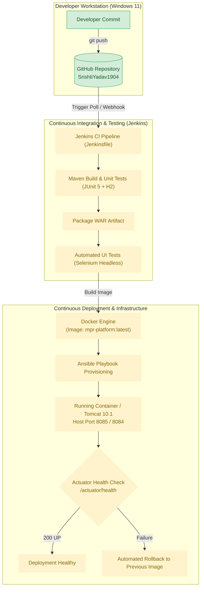

# Project Progress & DevOps Learning Guide

**Project Name:** Containerized Mobile Plan Recommendation Platform  
**GitHub Repository:** [https://github.com/SrishtiYadav1904/containerized-mobile-plan-recommendation-platform](https://github.com/SrishtiYadav1904/containerized-mobile-plan-recommendation-platform)  
**Student Name:** Srishti D Yadav  
**Roll Number:** 23102C0014  
**Guide Name:** Dr. Snehal Andhale  
**Academic Class:** DevOps CMPN C  
**Institution:** Vidyalankar Institute of Technology  
**Document Status:** Actively Maintained Project Progress Log & Viva Preparation Manual  

---

## Table of Contents
1. [Section A: Project Overview](#section-a-project-overview)
2. [Section B: Architecture and System Flow](#section-b-architecture-and-system-flow)
3. [Section C: Task-by-Task Progress (Tasks 1 to 15)](#section-c-task-by-task-progress-tasks-1-to-15)
4. [Section D: Current System State](#section-d-current-system-state)
5. [Section E: DevOps Concepts Learned (Glossary)](#section-e-devops-concepts-learned-glossary)
6. [Section F: End-to-End Demonstration Guide](#section-f-end-to-end-demonstration-guide)
7. [Section G: Next Steps](#section-g-next-steps)

---

## Section A: Project Overview

### 1. Problem Statement
In the telecom marketplace, consumers face hundreds of prepaid and postpaid tariffs with conflicting validity windows, daily data limits, voice quotas, and bundled perks (OTT, SMS, international roaming). Manually comparing plans across dispersed carrier portals is slow, error-prone, and frustrating. On the management side, telecom analysts frequently maintain plans in ad-hoc spreadsheets without peer review, leading to outdated prices and broken offers reaching customers.

On the operational side, traditional software delivery involves manual builds, file-copy server deployments, and untested releases. This leads to configuration drift, runtime failures in production, and zero rollback mechanisms.

### 2. The Platform Solution
The **Containerized Mobile Plan Recommendation Platform** is a secure, role-governed web application designed to solve both problems:
1. **Application Layer:** Provides a structured catalog review workflow where telecom analysts draft plans, administrators approve and publish them, and consumers receive personalized, ranked plan recommendations tailored to their usage and budget.
2. **DevOps Layer:** Enforces an automated, immutable deployment pipeline using Git branching, Maven build packaging, Jenkins CI/CD, Selenium headless testing, Docker containerization, and Ansible configuration management with automatic health checking and rollback.

### 3. Target Users & Access Control
- **`CUSTOMER`:** End-users. Can browse and filter only approved (`PUBLISHED`) mobile plans, input personal calling/data needs and budget constraints, and view ranked recommendations.
- **`ANALYST`:** Telecom catalog operators. Can create new plan drafts, modify draft attributes, submit plans for administrative review (`IN_REVIEW`), and view catalog summary statistics.
- **`ADMINISTRATOR`:** System owners. Can review submitted plans, publish (`PUBLISHED`) or retire (`ARCHIVED`) plans, manage user access, and inspect platform analytics.

### 4. 15-Task MVP Scope
The project scope is strictly frozen into a 15-task agile backlog:
1. Foundation & Database Schema
2. User Registration & Login (Form Authentication)
3. Role-Based Access Control (`CUSTOMER`, `ANALYST`, `ADMINISTRATOR`)
4. Plan Record Creation (Draft state)
5. Plan Catalogue List View
6. Plan Detail View
7. Plan Update & Audit Trail
8. Plan Search by Name & Operator
9. Plan Filtering by Price & Validity
10. Submission Workflow (`DRAFT → IN_REVIEW`)
11. Governance Workflow (`IN_REVIEW → PUBLISHED → ARCHIVED`)
12. Customer Usage & Budget Input Form
13. Recommendation Engine Scoring & Ranking
14. Catalogue Metrics Dashboard
15. Input Validation, Error Handling & Seed Data

### 5. Technology Stack & Technical Rationale

| Layer / Tool | Technology Selected | Rationale for Selection |
|---|---|---|
| **Language** | Java 17 LTS | Modern Long-Term Support release offering strong memory performance, pattern matching, and enterprise longevity. |
| **Framework** | Spring Boot 3.2.5 | Convention-over-configuration architecture with built-in production metrics (`Actuator`), high productivity, and robust JPA/Security starters. |
| **View Engine** | Thymeleaf + HTML5 / CSS3 | Fast server-rendered templating without requiring heavy JavaScript Single Page Application (SPA) builds. Ensures seamless mobile responsiveness. |
| **UI Aesthetics** | Custom Light Theme | Friendly, accessible light interface with soft pink (`#E86A92`) and lilac (`#8E7CC3`) accents; clean contrast and modern card layouts. |
| **Build Tool** | Apache Maven 3.9+ | Standardized dependency management, reproducible build phases (`compile`, `test`, `package`), and seamless Jenkins integration. |
| **Packaging** | Web Application Archive (WAR) | Allows flexible deployment: runnable as a standalone JAR/WAR locally, deployable into standalone Apache Tomcat 10.1, and containerizable in Docker. |
| **Database** | MySQL 8.0 & In-Memory H2 | In-memory H2 provides zero-setup, lightning-fast automated unit test runs; MySQL 8 provides ACID-compliant persistence for production. |
| **Continuous Integration** | Jenkins (Pipeline as Code) | Automates checkout, testing, packaging, and artefact archiving via declarative `Jenkinsfile`. |
| **Automated Testing** | JUnit 5 & Selenium WebDriver | JUnit 5 ensures backend logic correctness; Selenium simulates real customer browser interactions in headless Chrome. |
| **Containerization** | Docker | Packages the application and runtime environment into an immutable container image (`tomcat:10.1-jdk17`), eliminating "works on my machine" issues. |
| **Configuration Management** | Ansible | Declarative playbooks ensure target server environment idempotency, verify health probes, and execute automated rollback on failure. |

---

## Section B: Architecture and System Flow

### 1. Application Layer Flow
1. **Presentation (Browser):** The user interacts with responsive Thymeleaf templates rendered by Spring Boot.
2. **Security & Routing:** Spring Security intercepts incoming HTTP requests, authenticates user sessions, and verifies role authority before forwarding requests.
3. **Controller Layer:** Dispatches requests, binds form inputs, invokes business services, and returns view models or REST JSON payloads.
4. **Service & Algorithm Layer:** Contains core business logic, status transition validation (`DRAFT → IN_REVIEW → PUBLISHED → ARCHIVED`), and the transparent rule-based recommendation scorer.
5. **Data Access (JPA / Hibernate):** Spring Data JPA maps Java domain models to relational database tables, executing queries against MySQL 8 (or H2 during test runs).

### 2. DevOps Deployment Lifecycle Flow
$$\text{Developer Git Push} \longrightarrow \text{GitHub Webhook/Poll} \longrightarrow \text{Jenkins CI Pipeline} \longrightarrow \text{Maven Clean Test \& Package} \longrightarrow \text{Selenium Headless Tests} \longrightarrow \text{Docker Container Image Build} \longrightarrow \text{Ansible Provisioning \& Health Probe} \longrightarrow \text{Production Release (or Rollback)}$$



---

## Section C: Task-by-Task Progress (Tasks 1 to 15)

---

### Task 1 — Problem Definition and Scope
- **Task Objective:** Define the core problem, identify primary user classes, evaluate stakeholder pain points, establish project boundaries, and freeze the 15-task MVP scope.
- **What Was Implemented:** Authored formal system scope document. Categorized target users (`CUSTOMER`, `ANALYST`, `ADMINISTRATOR`), mapped the 4-state lifecycle workflow (`DRAFT`, `IN_REVIEW`, `PUBLISHED`, `ARCHIVED`), and defined measurable project success criteria.
- **Why It Matters:** Prevents scope creep and provides the architectural boundary before code or infrastructure is touched.
- **How It Works:** Compares real-world consumer confusion during mobile plan selection against telecom operational inefficiencies, establishing the exact features needed to solve both.
- **Tools Used:** Requirements engineering, Microsoft Word documentation (`devopsproj1to3_23102C0014.docx`).
- **Important Files:**
  - `devopsproj1to3_23102C0014.docx`: Original academic submission document.
  - `docs/tasks-1-3-summary.md`: Consolidated repository reference guide.
- **Commands Executed:** Baseline document synthesis.
- **Testing and Verification:** Approved by project guide Dr. Snehal Andhale.
- **Git Activity:** Baseline completed prior to Git repository initialization.
- **Evidence:** Document `devopsproj1to3_23102C0014.docx` in project root.
- **Problems Encountered:** Ambiguity in recommendation scoring; resolved by choosing a transparent rule-based algorithm over opaque machine learning.
- **Remaining Work:** None for Task 1.
- **Completion Status:** **Completed** (Approved baseline).
- **Viva Preparation:**
  - *Q1: Why was a rule-based algorithm selected instead of Machine Learning for plan recommendations?*  
    *Answer:* Mobile plan catalogues change frequently, and recommendations must be 100% explainable, deterministic, and instant based on strict user constraints (e.g., budget limits, exact validity days) rather than probabilistic statistical models.
  - *Q2: What are the three core user roles and their boundaries?*  
    *Answer:* Customer (browse published plans and receive recommendations), Analyst (create and edit plan drafts and submit for review), and Administrator (governance, publish/archive plans, user management).
  - *Q3: What are the four valid plan states?*  
    *Answer:* `DRAFT`, `IN_REVIEW`, `PUBLISHED`, and `ARCHIVED`.

---

### Task 2 — Agile Planning and DevOps Workflow
- **Task Objective:** Establish agile Scrum/Kanban delivery framework, draft user stories with acceptance criteria, build a product backlog with Fibonacci estimation, and define the Definition of Done.
- **What Was Implemented:** Created 12 user stories (US1–US12), mapped 4 sprints (Sprint 0 setup + 3 feature/DevOps sprints), designed Kanban board workflow with WIP limits (2), and formulated the Definition of Ready (DoR) and Definition of Done (DoD).
- **Why It Matters:** Ensures structured software engineering practices, traceability between code commits and requirements, and reliable release verification.
- **How It Works:** Work progresses from Backlog $\rightarrow$ To Do $\rightarrow$ In Progress $\rightarrow$ In Review (Pull Request) $\rightarrow$ Testing $\rightarrow$ Done (DoD verified).
- **Tools Used:** Scrum & Kanban methodology, Markdown trackers.
- **Important Files:**
  - `docs/tasks-1-3-summary.md` (Sections 2.1–2.7)
  - `TASK-TRACKER.md`: Ongoing task tracking matrix.
- **Commands Executed:** N/A (Methodological planning).
- **Testing and Verification:** User stories mapped directly to functional test cases.
- **Git Activity:** Baseline completed prior to Git initialization.
- **Evidence:** Tasks 1–3 documentation.
- **Problems Encountered:** Heavy third sprint; addressed by designating plan filtering as a "Should" requirement that can be rescheduled if needed.
- **Remaining Work:** None for Task 2.
- **Completion Status:** **Completed** (Approved baseline).
- **Viva Preparation:**
  - *Q1: What is the Definition of Done (DoD) in this DevOps project?*  
    *Answer:* An item is Done only when code is committed on a feature branch, passes local unit tests, passes Jenkins CI build and Selenium UI tests, has an approved PR merged into `develop`, satisfies all acceptance criteria, and contains zero hardcoded credentials.
  - *Q2: Why are WIP (Work In Progress) limits used on the Kanban board?*  
    *Answer:* WIP limits prevent multitasking bottlenecks, reduce context switching, and ensure developers finish reviewing and testing existing tasks before starting new ones.
  - *Q3: What is the Fibonacci estimation scale used in this project?*  
    *Answer:* 1, 2, 3, 5, and 8 story points, reflecting relative complexity, risk, and effort.

---

### Task 3 — Requirements, Architecture and Technology Setup
- **Task Objective:** Specify the Software Requirements Specification (SRS), logical architecture, database schema, REST API catalogue, technology choices, and port allocation policy.
- **What Was Implemented:** Produced complete SRS with 10 Functional Requirements (FR1–FR10) and 7 Non-Functional Requirements (NFR1–NFR7). Designed entity tables (`users`, `plans`, `recommendation_requests`, `recommendation_results`). Defined 9 primary REST endpoints. Formulated host port collision safeguards.
- **Why It Matters:** Provides the complete technical contract for development and avoids deployment collisions on host machines.
- **How It Works:** Establishes clear component boundaries between frontend templates, Spring controllers, JPA services, and persistence layers.
- **Tools Used:** Spring Boot architecture, MySQL Workbench, Markdown documentation.
- **Important Files:**
  - `docs/tasks-1-3-summary.md` (Sections 3.1–3.8)
- **Commands Executed:** Verification of tool prerequisites (`java -version`, `mvn -version`, `git --version`).
- **Testing and Verification:** Schema normalized to Third Normal Form (3NF). Port policy established.
- **Git Activity:** Baseline completed prior to Git initialization.
- **Evidence:** Tasks 1–3 documentation.
- **Problems Encountered:** Host machine had active services on ports 8072, 8081, and 8082; resolved by assigning application Tomcat port to 8084 and Docker published host port to 8085 (internal port 8080).
- **Remaining Work:** None for Task 3.
- **Completion Status:** **Completed** (Approved baseline).
- **Viva Preparation:**
  - *Q1: Why are ports 8072, 8081, and 8082 strictly avoided?*  
    *Answer:* Those ports are reserved by other pre-existing applications on the development system. To prevent binding conflicts and service crashes, Tomcat uses port 8084 and Docker uses host port 8085.
  - *Q2: What is the difference between H2 and MySQL in this project?*  
    *Answer:* H2 is an ultra-fast in-memory database used for automated unit tests without external dependencies; MySQL 8 is a persistent ACID database used for local execution and production runtime.
  - *Q3: What is the purpose of Spring Boot Actuator?*  
    *Answer:* It provides production-ready monitoring endpoints, specifically `/actuator/health`, which CI/CD pipelines and container orchestrators query to confirm the application is healthy.

---

### Task 4 — Git and GitHub Repository Initialization
- **Task Objective:** Initialize the version control repository for `containerized-mobile-plan-recommendation-platform` under GitHub owner `SrishtiYadav1904`, configure GitFlow branching rules, establish `.gitignore` and issue/PR templates, build the Spring Boot 3 / Java 17 skeleton with WAR packaging, verify automated tests, and publish to GitHub.
- **What Was Implemented:**
  1. Initialized Git repository with `main` and `develop` branches.
  2. Created Maven `pom.xml` with Spring Boot 3.2.5, Java 17 target, WAR packaging, and starters for Web, Thymeleaf, Security, JPA, Validation, Actuator, MySQL, and H2.
  3. Created Spring Boot entry point (`MobilePlanRecommendationApplication.java`), `SecurityConfig.java`, `HomeController.java`, responsive Thymeleaf landing page (`index.html`) with soft pink/lilac CSS styling (`styles.css`), and `application.properties`.
  4. Added comprehensive `.gitignore` filtering build artifacts (`target/`, `*.war`), IDE configurations, Windows OS files, and secrets (`.env`, `*.key`).
  5. Configured `.github/ISSUE_TEMPLATE/bug_report.md`, `feature_request.md`, and `.github/pull_request_template.md`.
  6. Authored `CONTRIBUTING.md`, project `README.md`, preserved task pack guide in `TASK-PACK-README.md`, and created `docs/tasks-1-3-summary.md`.
  7. Formally updated `TASK-TRACKER.md` and created `docs/task-reports/task-04.md`.
  8. Successfully authenticated via GitHub CLI (`gh auth login`) and published both `main` and `develop` branches to GitHub.
- **Why It Matters:** Establishes the foundational source control repository, automated build system, and team collaboration standards needed for all subsequent development and CI/CD pipelines.
- **How It Works:** Git tracks version history and manages branch isolation; Maven compiles Java source code and executes automated tests; GitHub hosts the centralized remote repository; GitHub CLI manages OAuth authentication.
- **Tools Used:** Git 2.47.0, GitHub, GitHub CLI (`gh`), Apache Maven 3.9.9, JDK 21 (running Java 17 compiler release), Spring Boot 3.2.5, JUnit 5.
- **Important Files:**
  - `pom.xml`: Root Maven build configuration.
  - `src/main/java/com/mpr/platform/MobilePlanRecommendationApplication.java`: Application main class.
  - `src/main/resources/application.properties`: Application runtime configuration.
  - `src/main/resources/templates/index.html`: Soft pink/lilac themed home page.
  - `src/main/resources/static/css/styles.css`: Custom responsive stylesheet.
  - `src/test/java/com/mpr/platform/MobilePlanRecommendationApplicationTests.java`: Context loads test.
  - `.gitignore`: Security and build artifact ignore rules.
  - `CONTRIBUTING.md`: Branching rules and Definition of Done.
  - `README.md`: Public platform documentation.
  - `docs/task-reports/task-04.md`: Detailed Task 4 outcome report.
- **Commands Executed:**
  ```powershell
  # 1. Initialize repository
  git init -b main
  # 2. Compile and run automated tests
  mvn clean test          # Outcome: BUILD SUCCESS (1 test run, 0 failures, 0 errors)
  # 3. Add remote origin
  git remote add origin https://github.com/SrishtiYadav1904/containerized-mobile-plan-recommendation-platform.git
  # 4. Authenticate via GitHub CLI
  gh auth login -h github.com -p https -w    # Logged in as SrishtiYadav1904
  gh auth setup-git                          # Configured git credential helper
  # 5. Push branches to GitHub
  git push -u origin main                    # Outcome: [new branch] main -> main
  git push -u origin develop                 # Outcome: [new branch] develop -> develop
  # 6. Verify remote branches via GitHub API
  gh api repos/SrishtiYadav1904/containerized-mobile-plan-recommendation-platform/branches
  ```
- **Testing and Verification:**
  - `mvn clean test` executed with `BUILD SUCCESS` in 26.8s.
  - Embedded H2 database initialized connection pool `HikariPool-1`.
  - Spring Boot Actuator endpoints `/actuator/health` and `/actuator/info` exposed.
  - Verified remote repository on GitHub: Public repository exists, both `main` and `develop` branches present, pointing to verified commit.
- **Git Activity:**
  - Repository URL: `https://github.com/SrishtiYadav1904/containerized-mobile-plan-recommendation-platform`
  - Active Branches: `main` (default release), `develop` (integration)
  - Key Commits:
    - `234e156`: `feat(init): initialize repository structure, Maven Spring Boot skeleton, and DevOps config (Task 4)`
    - `ad3134e`: `docs(report): record final commit hash and verification in task-04 report`
    - `f8a9b47`: `docs(report): update task-04 verification and manual publication steps`
    - `826890a`: `docs(report): finalize task-04 verification with confirmed GitHub publication`
- **Evidence:**
  - Task Report: [docs/task-reports/task-04.md](file:///e:/Downloads/containerized_mobile_plan_devops_task_pack/docs/task-reports/task-04.md)
  - GitHub Remote API Output: Both branches tracking `origin` cleanly.
  - Test Log: `C:\Users\Shreyas\.gemini\antigravity-ide\brain\5ab87586-0b4f-44d5-a383-377a38d54682\.system_generated\tasks\task-55.log`
- **Problems Encountered:**
  - *Problem 1:* Attempting to push triggered `HTTP 403: Permission denied to Jiraiyasaanin`.  
    *Root Cause:* Windows Git Credential Manager had cached credentials for a different GitHub user (`Jiraiyasaanin`).  
    *Resolution:* Ran `gh auth login -h github.com -p https -w` to authenticate as `SrishtiYadav1904`, followed by `gh auth setup-git` to bind Git credential helpers directly to the authorized account.
  - *Problem 2:* Password authentication failure in terminal.  
    *Root Cause:* GitHub deprecated standard account passwords for Git operations in 2021.  
    *Resolution:* Replaced password input with OAuth token via GitHub CLI browser authentication.
- **Remaining Work:** None. Task 4 is fully verified and published.
- **Completion Status:** **Completed** (Verified locally and on GitHub).
- **Viva Preparation:**
  - *Q1: Why is .gitignore crucial in a DevOps project?*  
    *Answer:* `.gitignore` prevents build artifacts (`target/`, `*.class`, `*.war`), IDE settings, and sensitive environment secrets (`.env`, private keys) from being tracked in version control, ensuring repository hygiene, security, and reproducibility.
  - *Q2: Explain the GitFlow branching strategy configured in this project.*  
    *Answer:* `main` stores stable, deployable production releases; `develop` serves as the integration branch for tested code; `feature/<task-id>-<short-name>` branches isolate new feature work and merge back into `develop` via pull requests.
  - *Q3: Why is WAR packaging configured in pom.xml instead of JAR?*  
    *Answer:* WAR packaging enables the application to be deployed directly into standalone Apache Tomcat 10.1 servers (required in Task 8) while retaining the ability to run as an embedded Spring Boot application locally.

---

### Task 5 — Feature Development with Branching
- **Task Objective:** Implement the first application feature on a dedicated branch (`feature/5-create-view-plans`): create and view mobile plan records for Analysts, enforce `DRAFT` status, restrict customer visibility to `PUBLISHED` plans, write unit tests, and raise a pull request targeting `develop`.
- **What Was Implemented:** *Not started yet.*
- **Why It Matters:** Demonstrates professional Git branching, entity modeling, status constraints, and service layer validation before merging into the main codebase.
- **How It Works:** Analysts submit plan creation requests via web form. Spring controller validates inputs, persists the entity with status `DRAFT`, and redirects to the catalog list. Customers querying the catalog receive only `PUBLISHED` plans.
- **Tools Used:** Git, Java 17, Spring Boot 3 (Web, Data JPA, Validation), Thymeleaf, JUnit 5.
- **Important Files:** Planned: `Plan.java`, `PlanRepository.java`, `PlanService.java`, `PlanController.java`, `plan-create.html`, `plan-list.html`.
- **Commands Executed:** Planned: `git checkout -b feature/5-create-view-plans develop`.
- **Testing and Verification:** Planned: Unit tests verifying field validation and role-based filtering.
- **Git Activity:** Planned: Feature branch `feature/5-create-view-plans`, commits, PR to `develop`.
- **Evidence:** Planned: `docs/task-reports/task-05.md`.
- **Problems Encountered:** None yet.
- **Remaining Work:** Create branch, implement entity, service, controller, templates, tests, commit, push, and submit PR.
- **Completion Status:** **Not started**.
- **Viva Preparation:**
  - *Q1: Why should feature development always happen on a separate branch?*  
    *Answer:* Branching isolates unfinished or experimental code from the stable integration branch (`develop`), enabling multiple developers to work concurrently without breaking the build.
  - *Q2: How does the application enforce that Customers only see PUBLISHED plans?*  
    *Answer:* The service layer filters catalog queries: when the authenticated user has the `CUSTOMER` role, it appends a `WHERE status = 'PUBLISHED'` predicate to the query.

---

### Task 6 — MVP Completion and Git Collaboration
- **Task Objective:** Complete remaining MVP features (user authentication, status transition workflow, recommendation scoring, summary dashboard), demonstrate Git collaboration including merge conflict resolution, and create a release tag `v1.0.0` on `main`.
- **What Was Implemented:** *Not started yet.*
- **Why It Matters:** Shows full feature completion and proves the developer can handle real-world Git conflict resolution and release tagging.
- **Completion Status:** **Not started**.
- **Viva Preparation:**
  - *Q1: What causes a Git merge conflict and how is it resolved?*  
    *Answer:* A conflict occurs when different branches make conflicting changes to the same lines of a file. Git pauses the merge, marks conflicts with `<<<<<<<`, `=======`, and `>>>>>>>`, and requires the developer to manually select the correct code, test it, and commit the resolution.
  - *Q2: What is a Git tag?*  
    *Answer:* A tag is an immutable reference pointing to a specific commit in Git history, typically used to mark release milestones like `v1.0.0`.

---

### Task 7 — Jenkins Installation and Continuous Integration Job
- **Task Objective:** Verify Jenkins availability, configure a continuous integration job for this repository with automated Git checkout, Maven clean test/package execution, JUnit test report publication, and artifact archiving.
- **What Was Implemented:** *Not started yet.*
- **Why It Matters:** Continuous Integration automatically verifies code on every push, catching bugs immediately and ensuring a working artifact is always available.
- **Completion Status:** **Not started**.
- **Viva Preparation:**
  - *Q1: What is Continuous Integration (CI)?*  
    *Answer:* CI is a software development practice where developers frequently integrate code into a shared repository, and each integration is verified by an automated build and test runner to detect defects rapidly.
  - *Q2: Why should build artifacts be archived in Jenkins?*  
    *Answer:* Archiving stores the exact deployable WAR/JAR generated during a verified build so it can be deployed or audited without recompiling.

---

### Task 8 — Pipeline as Code and Server Deployment
- **Task Objective:** Author a declarative `Jenkinsfile` with stages for Checkout, Build, Test, Package, Archive, and Deploy; deploy the WAR to standalone Apache Tomcat 10.1 on port 8084; verify Actuator health check.
- **What Was Implemented:** *Not started yet.*
- **Why It Matters:** Storing pipeline configuration in version control ("Pipeline as Code") ensures pipeline steps are versioned, reviewable, and reproducible across teams.
- **Completion Status:** **Not started**.
- **Viva Preparation:**
  - *Q1: What is "Pipeline as Code"?*  
    *Answer:* Defining the entire build, test, and deployment process in a version-controlled script (like a `Jenkinsfile`) rather than configuring jobs manually in a web UI.
  - *Q2: What is the difference between scripted and declarative Jenkins pipelines?*  
    *Answer:* Declarative syntax uses a structured, readable hierarchy with predefined blocks (`pipeline`, `stages`, `steps`, `post`), making it less error-prone than free-form Groovy-scripted pipelines.

---

### Task 9 — Selenium Test Design and Local Execution
- **Task Objective:** Design automated UI end-to-end test scripts using Selenium WebDriver covering critical user journeys (analyst creating a plan, customer viewing recommendations).
- **What Was Implemented:** *Not started yet.*
- **Why It Matters:** Unit tests check isolated methods, but end-to-end UI tests verify that HTML forms, browser sessions, JavaScript, and HTTP routes function harmoniously from a real user's perspective.
- **Completion Status:** **Not started**.
- **Viva Preparation:**
  - *Q1: What is Selenium WebDriver?*  
    *Answer:* A browser automation framework that directly controls a browser instance (such as Chrome or Firefox) to simulate user actions like clicking, typing, and submitting forms.
  - *Q2: Why are headless browsers used in CI pipelines?*  
    *Answer:* Headless browsers run in memory without rendering a physical GUI window, allowing fast, automated browser testing on servers without graphical display servers.

---

### Task 10 — Continuous Testing in Jenkins
- **Task Objective:** Integrate Selenium UI tests into the Jenkins pipeline with automated test reporting, demonstrate build failure when a UI test fails, fix the issue, and demonstrate a successful rebuild.
- **What Was Implemented:** *Not started yet.*
- **Why It Matters:** Proves the "quality gate" concept: failing tests must halt the pipeline before any deployment occurs.
- **Completion Status:** **Not started**.
- **Viva Preparation:**
  - *Q1: What is a "Quality Gate" in CI/CD?*  
    *Answer:* A mandatory check (such as unit test pass rate, code coverage, or UI test pass) that must succeed before an artifact is allowed to proceed to the next stage or to deployment.

---

### Task 11 — Docker Image and Container Lifecycle
- **Task Objective:** Create a root-level `Dockerfile` using `tomcat:10.1-jdk17`, package the WAR inside the container, configure container port 8080 mapped to host port 8085, and demonstrate image building and container management.
- **What Was Implemented:** *Not started yet.*
- **Why It Matters:** Containers bundle application binaries, runtime dependencies, and system libraries together, guaranteeing identical behavior across development, testing, and production servers.
- **Completion Status:** **Not started**.
- **Viva Preparation:**
  - *Q1: What is the difference between a Docker image and a Docker container?*  
    *Answer:* An image is a read-only template with instructions for building a container; a container is a running, isolated instance of that image.
  - *Q2: What does the port mapping -p 8085:8080 mean?*  
    *Answer:* It forwards traffic hitting port 8085 on the host operating system to port 8080 inside the isolated container where the web server is listening.

---

### Task 12 — Jenkins-Docker Continuous Deployment
- **Task Objective:** Extend the Jenkins pipeline to automatically build versioned Docker images upon successful tests, tag images, and deploy containers continuously.
- **What Was Implemented:** *Not started yet.*
- **Why It Matters:** Closes the gap between code integration and containerized deployment, ensuring validated code is packaged into deployable containers automatically.
- **Completion Status:** **Not started**.
- **Viva Preparation:**
  - *Q1: What is Continuous Deployment (CD)?*  
    *Answer:* The automated practice where every change that passes all stages of the CI pipeline is released automatically to production without human intervention.

---

### Task 13 — Configuration Management Script
- **Task Objective:** Author an Ansible playbook to automate server provisioning, package installation, runtime configuration, and directory setup.
- **What Was Implemented:** *Not started yet.*
- **Why It Matters:** Eliminates manual server configuration and ensures infrastructure setup is documented, version-controlled, and automated ("Infrastructure as Code").
- **Completion Status:** **Not started**.
- **Viva Preparation:**
  - *Q1: What is Ansible?*  
    *Answer:* An open-source, agentless configuration management and automation tool that uses declarative YAML playbooks to configure servers over SSH or local connections.

---

### Task 14 — Automated Provisioning and Reliability Validation
- **Task Objective:** Validate Ansible playbook idempotency, implement automated health-check verification via `/actuator/health`, and demonstrate automated rollback when a deployed version fails health verification.
- **What Was Implemented:** *Not started yet.*
- **Why It Matters:** Demonstrates production-grade reliability: idempotent provisioning ensures rerun safety, and automated rollback guarantees zero prolonged downtime if bad code slips through.
- **Completion Status:** **Not started**.
- **Viva Preparation:**
  - *Q1: What does "Idempotency" mean in configuration management?*  
    *Answer:* An operation is idempotent if executing it multiple times yields the exact same system state without duplicating side effects (e.g., ensuring a package is installed only if not already present).
  - *Q2: How does automated rollback work in containerized deployments?*  
    *Answer:* If the deployment health probe fails to receive a healthy HTTP 200 response from `/actuator/health` within a timeout, the orchestrator stops the faulty container and restarts the previous verified container image version.

---

### Task 15 — Documentation and Final Review
- **Task Objective:** Consolidate comprehensive project evidence, white paper, demonstration walkthrough, and final academic review.
- **What Was Implemented:** *Ongoing maintenance throughout all tasks.*
- **Why It Matters:** Synthesizes the end-to-end engineering journey for evaluators and establishes clear operational documentation.
- **Completion Status:** **In progress** (Actively documented via `PROJECT-PROGRESS.md`).

---

## Section D: Current System State

| Dimension | Current Verified State | Evidence / Location |
|---|---|---|
| **Active Local Branch** | `main` (clean working tree) | `git status` |
| **Active Remote Branches** | `main` and `develop` both synchronized with GitHub | `https://github.com/SrishtiYadav1904/containerized-mobile-plan-recommendation-platform` |
| **Latest Commit SHA** | `826890a` | `git log -n 1 --oneline` |
| **Working Application Features** | Spring Boot 3 web application initialization, basic home routing (`HomeController`), Actuator health endpoint (`/actuator/health`), in-memory H2 database, light theme UI foundation with soft pink/lilac accents. | `src/main/` |
| **Database Configuration** | Default: In-Memory H2 (`jdbc:h2:mem:mpr_db`). MySQL 8 configured via environment variable overrides (`DB_URL`, `DB_USER`, `DB_PASS`). | `src/main/resources/application.properties` |
| **Test Suite Results** | 1 test run, 0 failures, 0 errors, 0 skipped (`MobilePlanRecommendationApplicationTests`). | Maven Surefire Test Report (`target/surefire-reports/`) |
| **Jenkins Status** | Not started (Planned for Tasks 7 & 8). | N/A |
| **Docker Status** | Not started (Planned for Tasks 11 & 12). | N/A |
| **Ansible Status** | Not started (Planned for Tasks 13 & 14). | N/A |
| **Verified Working Ports** | Local development default: `8080`. Planned Tomcat: `8084`. Planned Docker host: `8085`. Reserved ports `8072`, `8081`, `8082` strictly avoided. | Port Policy in `README.md` |
| **Known Blockers** | None. Repository initialized and published. | `TASK-TRACKER.md` |

---

## Section E: DevOps Concepts Learned (Glossary)

- **Version Control System (VCS):** Software (like Git) that records changes to files over time, enabling developers to recall specific versions, compare differences, and collaborate without overwriting each other's work.
- **GitFlow:** A branching model where `main` contains production releases, `develop` serves as the integration branch, and dedicated `feature/` branches isolate task development.
- **Pull Request (PR):** A mechanism in Git hosting platforms (like GitHub) that notifies team members that a feature branch is ready for review, discussion, automated testing, and merging into a target branch.
- **Continuous Integration (CI):** An automated pipeline practice where code commits trigger automated compilation, static analysis, and test suites, ensuring regressions are detected immediately.
- **Continuous Delivery (CD):** An extension of CI where code changes are automatically tested and packaged, producing an artifact ready to be deployed to testing or production environments.
- **Continuous Deployment:** Full automation where every verified code change passing all test gates is deployed directly into production without human approval.
- **Build Lifecycle (Maven):** A sequence of phases including `validate`, `compile`, `test`, `package`, `verify`, `install`, and `deploy`. Running `mvn clean test` cleans previous build outputs, compiles source code, and executes test suites.
- **Web Application Archive (WAR):** A compressed package containing web application resources (servlets, JSPs/HTML, Java classes, libraries) designed for deployment on Java web application servers like Apache Tomcat.
- **Spring Boot Actuator:** A Spring sub-framework providing production metrics, health checks (`/actuator/health`), thread dumps, and application info via standard HTTP endpoints.
- **Headless Browser:** A web browser that executes without a visible user interface, operated programmatically (e.g., via Selenium WebDriver) for automated integration testing in CI environments.
- **Docker Image vs Container:** A Docker image is an immutable blueprint containing the code, runtime, system libraries, and settings. A Docker container is an isolated, executable runtime instance of that image.
- **Port Mapping (`-p <host>:<container>`):** Directs incoming network traffic from a specific port on the host operating system to a listening port inside a Docker container.
- **Infrastructure as Code (IaC):** The practice of provisioning and managing computing infrastructure using machine-readable configuration files (e.g., Ansible YAML playbooks) rather than physical hardware configuration or manual interactive tools.
- **Idempotency:** A property of configuration management operations whereby applying the same operation repeatedly yields the identical result without unintended state changes.
- **Automated Rollback:** A resilience mechanism that automatically reverts the running deployment to the previously verified, healthy container image or artifact if post-deployment health probes fail.

---

## Section F: End-to-End Demonstration Guide

When demonstrating the project in its current state (Tasks 1–4 Completed) to an evaluator:

### Step 1: Explain the Project Scope & Architecture
- **Action:** Open `README.md` and `PROJECT-PROGRESS.md`.
- **Explain:** Describe the real-world problem (confusing mobile plan options and unreviewed catalogue updates), the 3 roles (`CUSTOMER`, `ANALYST`, `ADMINISTRATOR`), the 4 plan states (`DRAFT → IN_REVIEW → PUBLISHED → ARCHIVED`), and the end-to-end DevOps pipeline.

### Step 2: Show GitHub Source Control & Branching
- **Action:** Navigate to [https://github.com/SrishtiYadav1904/containerized-mobile-plan-recommendation-platform](https://github.com/SrishtiYadav1904/containerized-mobile-plan-recommendation-platform).
- **Explain:** Show the published repository under owner `SrishtiYadav1904`. Highlight the two branches (`main` and `develop`), the issue templates (`.github/ISSUE_TEMPLATE/`), the pull request template, and the `.gitignore` preventing secrets and binaries from entering Git.

### Step 3: Demonstrate Local Maven Build & Test Execution
- **Action:** Open PowerShell in the project directory and run:
  ```powershell
  mvn clean test
  ```
- **Explain:** Point out that Maven compiles Java 17 source files using Spring Boot 3.2.5, starts an in-memory H2 database, exposes Actuator endpoints, and executes `MobilePlanRecommendationApplicationTests` with 0 failures and 0 errors.

### Step 4: Demonstrate Application Startup & Aesthetics
- **Action:** Run:
  ```powershell
  mvn spring-boot:run
  ```
- **Open Browser:** Navigate to `http://localhost:8080`.
- **Explain:** Point out the clean light-themed UI featuring soft pink (`#E86A92`) and lilac (`#8E7CC3`) accents.
- **Open Health Probe:** Navigate to `http://localhost:8080/actuator/health`.
- **Explain:** Show the `{"status":"UP"}` JSON response, which serves as the automated health check for Jenkins and Ansible in upcoming tasks.

---

## Section G: Next Steps

### Immediate Next Task: Task 5 — Feature Development with Branching

- **Goal:** Implement the foundational mobile plan catalog creation and view features for Analysts and Customers on a dedicated Git branch.
- **Prerequisites:**
  - Task 4 completed and verified (Satisfied ✅).
  - Branching from `develop` branch.
- **Actions Required:**
  1. Check out a new branch: `git checkout -b feature/5-create-view-plans develop`.
  2. Create the `Plan` JPA entity with the 8 approved attributes:
     - Operator, Name, Price, Validity (days), Daily Data (GB), Voice Minutes, SMS Count, Benefits, and Status (`DRAFT`).
  3. Create `PlanRepository`, `PlanService`, and `PlanController`.
  4. Create Thymeleaf templates: `plan-create.html` (Analyst creation form) and `plan-list.html` (Catalogue listing with customer visibility restriction).
  5. Add unit and integration tests.
  6. Commit changes with meaningful messages, push `feature/5-create-view-plans` to GitHub, and create a Pull Request targeting `develop`.
