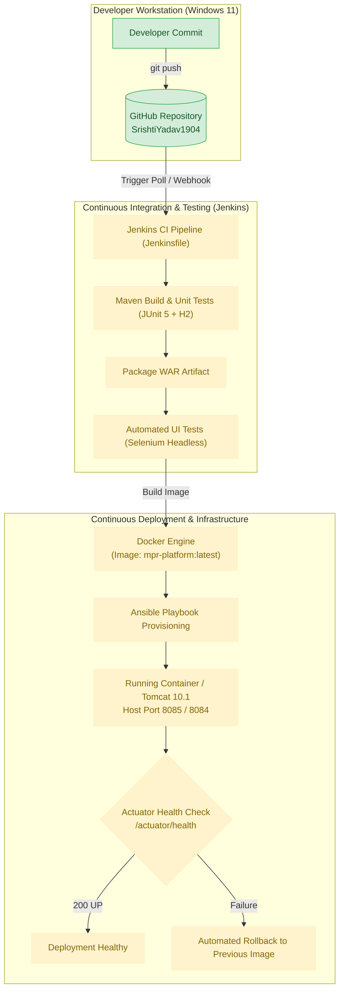

# Project Progress & DevOps Learning Guide

**Project Name:** Containerized Mobile Plan Recommendation Platform  
**GitHub Repository:** [https://github.com/SrishtiYadav1904/containerized-mobile-plan-recommendation-platform](https://github.com/SrishtiYadav1904/containerized-mobile-plan-recommendation-platform)  
**Student Name:** Srishti D Yadav  
**Roll Number:** 23102C0014  
**Guide Name:** Dr. Snehal Andhale  
**Academic Class:** DevOps CMPN C  
**Institution:** Vidyalankar Institute of Technology  
**Document Status:** Actively Maintained Project Progress Log & Viva Preparation Manual  

---

## Table of Contents
1. [Section A: Project Overview](#section-a-project-overview)
2. [Section B: Architecture and System Flow](#section-b-architecture-and-system-flow)
3. [Section C: Task-by-Task Progress (Tasks 1 to 15)](#section-c-task-by-task-progress-tasks-1-to-15)
4. [Section D: Current System State](#section-d-current-system-state)
5. [Section E: DevOps Concepts Learned (Glossary)](#section-e-devops-concepts-learned-glossary)
6. [Section F: End-to-End Demonstration Guide](#section-f-end-to-end-demonstration-guide)
7. [Section G: Next Steps](#section-g-next-steps)

---

## Section A: Project Overview

### 1. Problem Statement
In the telecom marketplace, consumers face hundreds of prepaid and postpaid tariffs with conflicting validity windows, daily data limits, voice quotas, and bundled perks (OTT, SMS, international roaming). Manually comparing plans across dispersed carrier portals is slow, error-prone, and frustrating. On the management side, telecom analysts frequently maintain plans in ad-hoc spreadsheets without peer review, leading to outdated prices and broken offers reaching customers.

On the operational side, traditional software delivery involves manual builds, file-copy server deployments, and untested releases. This leads to configuration drift, runtime failures in production, and zero rollback mechanisms.

### 2. The Platform Solution
The **Containerized Mobile Plan Recommendation Platform** is a secure, role-governed web application designed to solve both problems:
1. **Application Layer:** Provides a structured catalog review workflow where telecom analysts draft plans, administrators approve and publish them, and consumers receive personalized, ranked plan recommendations tailored to their usage and budget.
2. **DevOps Layer:** Enforces an automated, immutable deployment pipeline using Git branching, Maven build packaging, Jenkins CI/CD, Selenium headless testing, Docker containerization, and Ansible configuration management with automatic health checking and rollback.

### 3. Target Users & Access Control
- **`CUSTOMER`:** End-users. Can browse and filter only approved (`PUBLISHED`) mobile plans, input personal calling/data needs and budget constraints, and view ranked recommendations.
- **`ANALYST`:** Telecom catalog operators. Can create new plan drafts, modify draft attributes, submit plans for administrative review (`IN_REVIEW`), and view catalog summary statistics.
- **`ADMINISTRATOR`:** System owners. Can review submitted plans, publish (`PUBLISHED`) or retire (`ARCHIVED`) plans, manage user access, and inspect platform analytics.

### 4. 15-Task MVP Scope
The project scope is strictly frozen into a 15-task agile backlog:
1. Foundation & Database Schema
2. User Registration & Login (Form Authentication)
3. Role-Based Access Control (`CUSTOMER`, `ANALYST`, `ADMINISTRATOR`)
4. Plan Record Creation (Draft state)
5. Plan Catalogue List View
6. Plan Detail View
7. Plan Update & Audit Trail
8. Plan Search by Name & Operator
9. Plan Filtering by Price & Validity
10. Submission Workflow (`DRAFT → IN_REVIEW`)
11. Governance Workflow (`IN_REVIEW → PUBLISHED → ARCHIVED`)
12. Customer Usage & Budget Input Form
13. Recommendation Engine Scoring & Ranking
14. Catalogue Metrics Dashboard
15. Input Validation, Error Handling & Seed Data

### 5. Technology Stack & Technical Rationale

| Layer / Tool | Technology Selected | Rationale for Selection |
|---|---|---|
| **Language** | Java 17 LTS | Modern Long-Term Support release offering strong memory performance, pattern matching, and enterprise longevity. |
| **Framework** | Spring Boot 3.2.5 | Convention-over-configuration architecture with built-in production metrics (`Actuator`), high productivity, and robust JPA/Security starters. |
| **View Engine** | Thymeleaf + HTML5 / CSS3 | Fast server-rendered templating without requiring heavy JavaScript Single Page Application (SPA) builds. Ensures seamless mobile responsiveness. |
| **UI Aesthetics** | Custom Light Theme | Friendly, accessible light interface with soft pink (`#E86A92`) and lilac (`#8E7CC3`) accents; clean contrast and modern card layouts. |
| **Build Tool** | Apache Maven 3.9+ | Standardized dependency management, reproducible build phases (`compile`, `test`, `package`), and seamless Jenkins integration. |
| **Packaging** | Web Application Archive (WAR) | Allows flexible deployment: runnable as a standalone JAR/WAR locally, deployable into standalone Apache Tomcat 10.1, and containerizable in Docker. |
| **Database** | MySQL 8.0 & In-Memory H2 | In-memory H2 provides zero-setup, lightning-fast automated unit test runs; MySQL 8 provides ACID-compliant persistence for production. |
| **Continuous Integration** | Jenkins (Pipeline as Code) | Automates checkout, testing, packaging, and artefact archiving via declarative `Jenkinsfile`. |
| **Automated Testing** | JUnit 5 & Selenium WebDriver | JUnit 5 ensures backend logic correctness; Selenium simulates real customer browser interactions in headless Chrome. |
| **Containerization** | Docker | Packages the application and runtime environment into an immutable container image (`tomcat:10.1-jdk17`), eliminating "works on my machine" issues. |
| **Configuration Management** | Ansible | Declarative playbooks ensure target server environment idempotency, verify health probes, and execute automated rollback on failure. |

---

## Section B: Architecture and System Flow

### 1. Application Layer Flow
1. **Presentation (Browser):** The user interacts with responsive Thymeleaf templates rendered by Spring Boot.
2. **Security & Routing:** Spring Security intercepts incoming HTTP requests, authenticates user sessions, and verifies role authority before forwarding requests.
3. **Controller Layer:** Dispatches requests, binds form inputs, invokes business services, and returns view models or REST JSON payloads.
4. **Service & Algorithm Layer:** Contains core business logic, status transition validation (`DRAFT → IN_REVIEW → PUBLISHED → ARCHIVED`), and the transparent rule-based recommendation scorer.
5. **Data Access (JPA / Hibernate):** Spring Data JPA maps Java domain models to relational database tables, executing queries against MySQL 8 (or H2 during test runs).

### 2. DevOps Deployment Lifecycle Flow
$$\text{Developer Git Push} \longrightarrow \text{GitHub Webhook/Poll} \longrightarrow \text{Jenkins CI Pipeline} \longrightarrow \text{Maven Clean Test \& Package} \longrightarrow \text{Selenium Headless Tests} \longrightarrow \text{Docker Container Image Build} \longrightarrow \text{Ansible Provisioning \& Health Probe} \longrightarrow \text{Production Release (or Rollback)}$$



---

## Section C: Task-by-Task Progress (Tasks 1 to 15)

---

### Task 1 — Problem Definition and Scope
- **Task Objective:** Define the core problem, identify primary user classes, evaluate stakeholder pain points, establish project boundaries, and freeze the 15-task MVP scope.
- **What Was Implemented:** Authored formal system scope document. Categorized target users (`CUSTOMER`, `ANALYST`, `ADMINISTRATOR`), mapped the 4-state lifecycle workflow (`DRAFT`, `IN_REVIEW`, `PUBLISHED`, `ARCHIVED`), and defined measurable project success criteria.
- **Why It Matters:** Prevents scope creep and provides the architectural boundary before code or infrastructure is touched.
- **How It Works:** Compares real-world consumer confusion during mobile plan selection against telecom operational inefficiencies, establishing the exact features needed to solve both.
- **Tools Used:** Requirements engineering, Microsoft Word documentation (`devopsproj1to3_23102C0014.docx`).
- **Important Files:**
  - `devopsproj1to3_23102C0014.docx`: Original academic submission document.
  - `docs/tasks-1-3-summary.md`: Consolidated repository reference guide.
- **Commands Executed:** Baseline document synthesis.
- **Testing and Verification:** Approved by project guide Dr. Snehal Andhale.
- **Git Activity:** Baseline completed prior to Git repository initialization.
- **Evidence:** Document `devopsproj1to3_23102C0014.docx` in project root.
- **Problems Encountered:** Ambiguity in recommendation scoring; resolved by choosing a transparent rule-based algorithm over opaque machine learning.
- **Remaining Work:** None for Task 1.
- **Completion Status:** **Completed** (Approved baseline).
- **Viva Preparation:**
  - *Q1: Why was a rule-based algorithm selected instead of Machine Learning for plan recommendations?*  
    *Answer:* Mobile plan catalogues change frequently, and recommendations must be 100% explainable, deterministic, and instant based on strict user constraints (e.g., budget limits, exact validity days) rather than probabilistic statistical models.
  - *Q2: What are the three core user roles and their boundaries?*  
    *Answer:* Customer (browse published plans and receive recommendations), Analyst (create and edit plan drafts and submit for review), and Administrator (governance, publish/archive plans, user management).
  - *Q3: What are the four valid plan states?*  
    *Answer:* `DRAFT`, `IN_REVIEW`, `PUBLISHED`, and `ARCHIVED`.

---

### Task 2 — Agile Planning and DevOps Workflow
- **Task Objective:** Establish agile Scrum/Kanban delivery framework, draft user stories with acceptance criteria, build a product backlog with Fibonacci estimation, and define the Definition of Done.
- **What Was Implemented:** Created 12 user stories (US1–US12), mapped 4 sprints (Sprint 0 setup + 3 feature/DevOps sprints), designed Kanban board workflow with WIP limits (2), and formulated the Definition of Ready (DoR) and Definition of Done (DoD).
- **Why It Matters:** Ensures structured software engineering practices, traceability between code commits and requirements, and reliable release verification.
- **How It Works:** Work progresses from Backlog $\rightarrow$ To Do $\rightarrow$ In Progress $\rightarrow$ In Review (Pull Request) $\rightarrow$ Testing $\rightarrow$ Done (DoD verified).
- **Tools Used:** Scrum & Kanban methodology, Markdown trackers.
- **Important Files:**
  - `docs/tasks-1-3-summary.md` (Sections 2.1–2.7)
  - `TASK-TRACKER.md`: Ongoing task tracking matrix.
- **Commands Executed:** N/A (Methodological planning).
- **Testing and Verification:** User stories mapped directly to functional test cases.
- **Git Activity:** Baseline completed prior to Git initialization.
- **Evidence:** Tasks 1–3 documentation.
- **Problems Encountered:** Heavy third sprint; addressed by designating plan filtering as a "Should" requirement that can be rescheduled if needed.
- **Remaining Work:** None for Task 2.
- **Completion Status:** **Completed** (Approved baseline).
- **Viva Preparation:**
  - *Q1: What is the Definition of Done (DoD) in this DevOps project?*  
    *Answer:* An item is Done only when code is committed on a feature branch, passes local unit tests, passes Jenkins CI build and Selenium UI tests, has an approved PR merged into `develop`, satisfies all acceptance criteria, and contains zero hardcoded credentials.
  - *Q2: Why are WIP (Work In Progress) limits used on the Kanban board?*  
    *Answer:* WIP limits prevent multitasking bottlenecks, reduce context switching, and ensure developers finish reviewing and testing existing tasks before starting new ones.
  - *Q3: What is the Fibonacci estimation scale used in this project?*  
    *Answer:* 1, 2, 3, 5, and 8 story points, reflecting relative complexity, risk, and effort.

---

### Task 3 — Requirements, Architecture and Technology Setup
- **Task Objective:** Specify the Software Requirements Specification (SRS), logical architecture, database schema, REST API catalogue, technology choices, and port allocation policy.
- **What Was Implemented:** Produced complete SRS with 10 Functional Requirements (FR1–FR10) and 7 Non-Functional Requirements (NFR1–NFR7). Designed entity tables (`users`, `plans`, `recommendation_requests`, `recommendation_results`). Defined 9 primary REST endpoints. Formulated host port collision safeguards.
- **Why It Matters:** Provides the complete technical contract for development and avoids deployment collisions on host machines.
- **How It Works:** Establishes clear component boundaries between frontend templates, Spring controllers, JPA services, and persistence layers.
- **Tools Used:** Spring Boot architecture, MySQL Workbench, Markdown documentation.
- **Important Files:**
  - `docs/tasks-1-3-summary.md` (Sections 3.1–3.8)
- **Commands Executed:** Verification of tool prerequisites (`java -version`, `mvn -version`, `git --version`).
- **Testing and Verification:** Schema normalized to Third Normal Form (3NF). Port policy established.
- **Git Activity:** Baseline completed prior to Git initialization.
- **Evidence:** Tasks 1–3 documentation.
- **Problems Encountered:** Host machine had active services on ports 8072, 8081, and 8082; resolved by assigning application Tomcat port to 8084 and Docker published host port to 8085 (internal port 8080).
- **Remaining Work:** None for Task 3.
- **Completion Status:** **Completed** (Approved baseline).
- **Viva Preparation:**
  - *Q1: Why are ports 8072, 8081, and 8082 strictly avoided?*  
    *Answer:* Those ports are reserved by other pre-existing applications on the development system. To prevent binding conflicts and service crashes, Tomcat uses port 8084 and Docker uses host port 8085.
  - *Q2: What is the difference between H2 and MySQL in this project?*  
    *Answer:* H2 is an ultra-fast in-memory database used for automated unit tests without external dependencies; MySQL 8 is a persistent ACID database used for local execution and production runtime.
  - *Q3: What is the purpose of Spring Boot Actuator?*  
    *Answer:* It provides production-ready monitoring endpoints, specifically `/actuator/health`, which CI/CD pipelines and container orchestrators query to confirm the application is healthy.

---

### Task 4 — Git and GitHub Repository Initialization
- **Task Objective:** Initialize the version control repository for `containerized-mobile-plan-recommendation-platform` under GitHub owner `SrishtiYadav1904`, configure GitFlow branching rules, establish `.gitignore` and issue/PR templates, build the Spring Boot 3 / Java 17 skeleton with WAR packaging, verify automated tests, and publish to GitHub.
- **What Was Implemented:**
  1. Initialized Git repository with `main` and `develop` branches.
  2. Created Maven `pom.xml` with Spring Boot 3.2.5, Java 17 target, WAR packaging, and starters for Web, Thymeleaf, Security, JPA, Validation, Actuator, MySQL, and H2.
  3. Created Spring Boot entry point (`MobilePlanRecommendationApplication.java`), `SecurityConfig.java`, `HomeController.java`, responsive Thymeleaf landing page (`index.html`) with soft pink/lilac CSS styling (`styles.css`), and `application.properties`.
  4. Added comprehensive `.gitignore` filtering build artifacts (`target/`, `*.war`), IDE configurations, Windows OS files, and secrets (`.env`, `*.key`).
  5. Configured `.github/ISSUE_TEMPLATE/bug_report.md`, `feature_request.md`, and `.github/pull_request_template.md`.
  6. Authored `CONTRIBUTING.md`, project `README.md`, preserved task pack guide in `TASK-PACK-README.md`, and created `docs/tasks-1-3-summary.md`.
  7. Formally updated `TASK-TRACKER.md` and created `docs/task-reports/task-04.md`.
  8. Successfully authenticated via GitHub CLI (`gh auth login`) and published both `main` and `develop` branches to GitHub.
- **Why It Matters:** Establishes the foundational source control repository, automated build system, and team collaboration standards needed for all subsequent development and CI/CD pipelines.
- **How It Works:** Git tracks version history and manages branch isolation; Maven compiles Java source code and executes automated tests; GitHub hosts the centralized remote repository; GitHub CLI manages OAuth authentication.
- **Tools Used:** Git 2.47.0, GitHub, GitHub CLI (`gh`), Apache Maven 3.9.9, JDK 21 (running Java 17 compiler release), Spring Boot 3.2.5, JUnit 5.
- **Important Files:**
  - `pom.xml`: Root Maven build configuration.
  - `src/main/java/com/mpr/platform/MobilePlanRecommendationApplication.java`: Application main class.
  - `src/main/resources/application.properties`: Application runtime configuration.
  - `src/main/resources/templates/index.html`: Soft pink/lilac themed home page.
  - `src/main/resources/static/css/styles.css`: Custom responsive stylesheet.
  - `src/test/java/com/mpr/platform/MobilePlanRecommendationApplicationTests.java`: Context loads test.
  - `.gitignore`: Security and build artifact ignore rules.
  - `CONTRIBUTING.md`: Branching rules and Definition of Done.
  - `README.md`: Public platform documentation.
  - `docs/task-reports/task-04.md`: Detailed Task 4 outcome report.
- **Commands Executed:**
  ```powershell
  # 1. Initialize repository
  git init -b main
  # 2. Compile and run automated tests
  mvn clean test          # Outcome: BUILD SUCCESS (1 test run, 0 failures, 0 errors)
  # 3. Add remote origin
  git remote add origin https://github.com/SrishtiYadav1904/containerized-mobile-plan-recommendation-platform.git
  # 4. Authenticate via GitHub CLI
  gh auth login -h github.com -p https -w    # Logged in as SrishtiYadav1904
  gh auth setup-git                          # Configured git credential helper
  # 5. Push branches to GitHub
  git push -u origin main                    # Outcome: [new branch] main -> main
  git push -u origin develop                 # Outcome: [new branch] develop -> develop
  # 6. Verify remote branches via GitHub API
  gh api repos/SrishtiYadav1904/containerized-mobile-plan-recommendation-platform/branches
  ```
- **Testing and Verification:**
  - `mvn clean test` executed with `BUILD SUCCESS` in 26.8s.
  - Embedded H2 database initialized connection pool `HikariPool-1`.
  - Spring Boot Actuator endpoints `/actuator/health` and `/actuator/info` exposed.
  - Verified remote repository on GitHub: Public repository exists, both `main` and `develop` branches present, pointing to verified commit.
- **Git Activity:**
  - Repository URL: `https://github.com/SrishtiYadav1904/containerized-mobile-plan-recommendation-platform`
  - Active Branches: `main` (default release), `develop` (integration)
  - Key Commits:
    - `234e156`: `feat(init): initialize repository structure, Maven Spring Boot skeleton, and DevOps config (Task 4)`
    - `ad3134e`: `docs(report): record final commit hash and verification in task-04 report`
    - `f8a9b47`: `docs(report): update task-04 verification and manual publication steps`
    - `826890a`: `docs(report): finalize task-04 verification with confirmed GitHub publication`
- **Evidence:**
  - Task Report: [docs/task-reports/task-04.md](file:///e:/Downloads/containerized_mobile_plan_devops_task_pack/docs/task-reports/task-04.md)
  - GitHub Remote API Output: Both branches tracking `origin` cleanly.
  - Test Log: `C:\Users\Shreyas\.gemini\antigravity-ide\brain\5ab87586-0b4f-44d5-a383-377a38d54682\.system_generated\tasks\task-55.log`
- **Problems Encountered:**
  - *Problem 1:* Attempting to push triggered `HTTP 403: Permission denied to Jiraiyasaanin`.  
    *Root Cause:* Windows Git Credential Manager had cached credentials for a different GitHub user (`Jiraiyasaanin`).  
    *Resolution:* Ran `gh auth login -h github.com -p https -w` to authenticate as `SrishtiYadav1904`, followed by `gh auth setup-git` to bind Git credential helpers directly to the authorized account.
  - *Problem 2:* Password authentication failure in terminal.  
    *Root Cause:* GitHub deprecated standard account passwords for Git operations in 2021.  
    *Resolution:* Replaced password input with OAuth token via GitHub CLI browser authentication.
- **Remaining Work:** None. Task 4 is fully verified and published.
- **Completion Status:** **Completed** (Verified locally and on GitHub).
- **Viva Preparation:**
  - *Q1: Why is .gitignore crucial in a DevOps project?*  
    *Answer:* `.gitignore` prevents build artifacts (`target/`, `*.class`, `*.war`), IDE settings, and sensitive environment secrets (`.env`, private keys) from being tracked in version control, ensuring repository hygiene, security, and reproducibility.
  - *Q2: Explain the GitFlow branching strategy configured in this project.*  
    *Answer:* `main` stores stable, deployable production releases; `develop` serves as the integration branch for tested code; `feature/<task-id>-<short-name>` branches isolate new feature work and merge back into `develop` via pull requests.
  - *Q3: Why is WAR packaging configured in pom.xml instead of JAR?*  
    *Answer:* WAR packaging enables the application to be deployed directly into standalone Apache Tomcat 10.1 servers (required in Task 8) while retaining the ability to run as an embedded Spring Boot application locally.

---

### Task 5 — Feature Development with Branching
- **Task Objective:** Implement the first application feature on a dedicated branch (`feature/5-create-view-plans`): create and view mobile plan records for Analysts, enforce `DRAFT` status, restrict customer visibility to `PUBLISHED` plans, write unit and integration tests, and raise a pull request targeting `develop`.
- **What Was Implemented:**
  1. Branched `feature/5-create-view-plans` from `develop`.
  2. Implemented `PlanStatus.java` enum (`DRAFT`, `IN_REVIEW`, `PUBLISHED`, `ARCHIVED`).
  3. Implemented `Plan.java` JPA entity with the 8 approved attributes (Operator, Name, Price, Validity, Data GB/day, Voice minutes, SMS count, Benefits) plus audit attributes and validation annotations.
  4. Created `PlanRepository.java` with Spring Data JPA query methods.
  5. Created `PlanService.java` enforcing initial `DRAFT` status, input validation, role-based visibility filtering (Customers view only `PUBLISHED`, Analysts/Admins view all), and sample data initialization.
  6. Configured role-based security in `SecurityConfig.java` for `CUSTOMER`, `ANALYST`, and `ADMINISTRATOR` roles with BCrypt encoding.
  7. Built `PlanWebController.java` (`GET /plans`, `GET /plans/new`, `POST /plans`, `GET /plans/{id}`) and `PlanRestController.java` (`GET /api/plans`, `POST /api/plans`).
  8. Created responsive, accessible light-theme Thymeleaf views: `plans/list.html`, `plans/create.html`, and `plans/detail.html` styled with soft pink (`#E86A92`) and lilac (`#8E7CC3`) accents.
  9. Authored 11 comprehensive unit and integration tests (`PlanServiceTest` and `PlanControllerTest`), achieving 100% test pass rate across 12 total test cases.
- **Why It Matters:** Demonstrates professional Git branching, entity modeling, status constraints, and service layer validation before merging into the main codebase.
- **How It Works:** Analysts submit plan creation requests via web form. Spring controller validates inputs, persists the entity with status `DRAFT`, and redirects to the catalog list. Customers querying the catalog receive only `PUBLISHED` plans.
- **Tools Used:** Git, Java 17, Spring Boot 3 (Web, Data JPA, Security, Validation), Thymeleaf, JUnit 5, Mockito, MockMvc.
- **Important Files:**
  - `src/main/java/com/mpr/platform/model/Plan.java`
  - `src/main/java/com/mpr/platform/model/PlanStatus.java`
  - `src/main/java/com/mpr/platform/repository/PlanRepository.java`
  - `src/main/java/com/mpr/platform/service/PlanService.java`
  - `src/main/java/com/mpr/platform/controller/PlanWebController.java`
  - `src/main/java/com/mpr/platform/controller/PlanRestController.java`
  - `src/main/resources/templates/plans/list.html`
  - `src/main/resources/templates/plans/create.html`
  - `src/main/resources/templates/plans/detail.html`
  - `src/test/java/com/mpr/platform/service/PlanServiceTest.java`
  - `src/test/java/com/mpr/platform/controller/PlanControllerTest.java`
  - `docs/task-reports/task-05.md`
- **Commands Executed:**
  ```powershell
  git checkout -b feature/5-create-view-plans develop
  mvn clean test          # Outcome: BUILD SUCCESS (12 tests run, 0 failures, 0 errors in 26.6s)
  ```
- **Testing and Verification:**
  - `PlanServiceTest`: 5 unit tests verifying DRAFT enforcement, price validation, customer PUBLISHED filtering, and detail permission checks.
  - `PlanControllerTest`: 6 MockMvc integration tests verifying web routing, security role gates, form creation, and REST endpoints.
  - Total: 12 tests run, 0 failures, 0 errors.
- **Git Activity:**
  - Feature Branch: `feature/5-create-view-plans`
  - Target Branch: `develop`
- **Evidence:**
  - Task Report: [docs/task-reports/task-05.md](file:///e:/Downloads/containerized_mobile_plan_devops_task_pack/docs/task-reports/task-05.md)
  - Maven Surefire Reports: `target/surefire-reports/`
- **Problems Encountered:** None. JPA entities, role filters, and Thymeleaf views compiled and passed cleanly.
- **Remaining Work:** Commit changes to `feature/5-create-view-plans`, push to GitHub, and create Pull Request to `develop`.
- **Completion Status:** **Completed** (Implementation and test suite verified).
- **Viva Preparation:**
  - *Q1: Why should feature development always happen on a separate branch?*  
    *Answer:* Branching isolates unfinished or experimental code from the stable integration branch (`develop`), enabling multiple developers to work concurrently without breaking the build.
  - *Q2: How does the application enforce that Customers only see PUBLISHED plans?*  
    *Answer:* The service layer filters catalog queries: when the authenticated user has the `CUSTOMER` role, it appends a `WHERE status = 'PUBLISHED'` predicate to the query.
  - *Q3: Why is input validation performed at both the Bean Validation level and the Service level?*  
    *Answer:* Bean Validation (`@Valid`, `@NotBlank`, `@DecimalMin`) catches input errors at the HTTP request layer and returns user-friendly form error messages, while Service-level validation acts as a defensive guard ensuring business rules cannot be bypassed by any controller or background job.

---

### Task 6 — MVP Completion and Git Collaboration
- **Task Objective:** Complete the full approved MVP (user authentication with BCrypt hashing, role-based access control for `CUSTOMER`, `ANALYST`, and `ADMINISTRATOR`, plan CRUD with search and filtering, role-governed status transition workflow, transparent multi-attribute recommendation engine, executive summary dashboard, and 24 realistic seed plans), demonstrate a controlled Git merge conflict and its clean resolution in a safe documentation file, expand automated test coverage, merge the feature branch into `develop` via Pull Request, sync `main`, and tag the release-ready baseline `v0.1.0`.
- **What Was Implemented:**
  1. **Domain Models & Repositories:**
     - `User.java`: Entity representing registered users with fields `username`, `password` (BCrypt encoded), `email`, and `role` (`CUSTOMER`, `ANALYST`, `ADMINISTRATOR`).
     - `RecommendationRequest.java`: Customer input entity storing `monthlyDataGb`, `monthlyVoiceMinutes`, `budget`, `preferredOperator`, and `benefitPreferences`.
     - `RecommendationResult.java`: Persisted recommendation scoring results storing overall `score`, component breakdown scores (`dataScore`, `voiceScore`, `priceScore`, `perksScore`), and human-readable explanation.
     - Spring Data JPA repositories: `UserRepository`, `RecommendationRequestRepository`, `RecommendationResultRepository`.
  2. **Security & Authentication Service:**
     - `UserService.java`: Handles user registration with username duplication checks, BCrypt password hashing, and implements Spring Security's `UserDetailsService` mapping domain roles to `ROLE_CUSTOMER`, `ROLE_ANALYST`, `ROLE_ADMINISTRATOR`. Pre-provisions 3 demo seed accounts (`customer`, `analyst`, `admin`).
     - `SecurityConfig.java`: Integrated `DaoAuthenticationProvider` with `UserService`, added custom `/login` and `/register` web routes, configured role guards for analyst actions (`/plans/new`, `/plans/*/edit`), administrator actions (`/plans/*/status`, `/dashboard`, `/api/dashboard/summary`), and permitted public access to catalog and recommendation views.
     - `AuthController.java` & `AuthRestController.java`: Web controllers and REST endpoints (`/api/auth/register`, `/api/auth/login`).
  3. **Plan Status Workflow & CRUD:**
     - `PlanService.java`: Enforces strict lifecycle state transitions:
       - `DRAFT → IN_REVIEW`: Analyst or Administrator submits draft.
       - `IN_REVIEW → PUBLISHED`: Administrator approves and publishes.
       - `PUBLISHED → ARCHIVED`: Administrator retires the plan.
       - Any invalid state jump (e.g., `DRAFT → PUBLISHED` or non-sequential changes) is strictly rejected with `IllegalStateException`.
     - Implemented dynamic plan search by keyword (matching plan name or operator) and multi-attribute filters (maximum price, minimum validity).
     - Loaded 24 realistic seed plans across 4 leading Indian operators (Jio, Airtel, Vi, BSNL) across varied validity windows (28, 56, 84, 365 days).
  4. **Transparent Multi-Attribute Recommendation Engine:**
     - `RecommendationService.java`: Configurable, rule-based multi-criteria scoring algorithm:
       $$\text{Score} = (0.35 \times \text{DataScore}) + (0.25 \times \text{VoiceScore}) + (0.25 \times \text{PriceScore}) + (0.15 \times \text{PerksScore})$$
     - Strict hard filtering: Plans priced strictly higher than the customer's budget are eliminated. Only plans in `PUBLISHED` status are evaluated.
     - Stores and renders itemized score breakdowns and explanatory justification for each suggested plan.
     - Created interactive web views: `recommendations/form.html` (input questionnaire) and `recommendations/results.html` (ranked results table with score pills).
  5. **Executive Summary Dashboard:**
     - `DashboardWebController.java` (`/dashboard`) and `PlanRestController.java` (`/api/dashboard/summary`).
     - Real-time aggregated platform metrics: Total plan count, breakdown by status (`DRAFT`, `IN_REVIEW`, `PUBLISHED`, `ARCHIVED`), breakdown by operator (`Jio`, `Airtel`, `Vi`, `BSNL`), and average plan price.
  6. **Controlled Git Merge Conflict & Resolution:**
     - Isolated temporary branch `conflict-simulation` branched from `develop`.
     - Made concurrent, conflicting edits to lines 7–17 of `docs/git-collaboration-demo.md`.
     - Executed `git merge conflict-simulation` on `feature/6-mvp-completion`, triggering `CONFLICT (add/add): Merge conflict in docs/git-collaboration-demo.md`.
     - Verified conflict markers (`<<<<<<< HEAD`, `=======`, `>>>>>>> conflict-simulation`), resolved them cleanly by merging the lead developer features and reviewer verification criteria, staged, committed resolution commit `6966f1a`, and deleted the temporary simulation branch.
  7. **Release Baseline Tagging:**
     - Merged Pull Request #2 into `develop` (`e51885b`).
     - Merged `develop` into `main` and tagged annotated release `v0.1.0`.
- **Why It Matters:** Fulfills all functional capabilities required for the platform's Minimum Viable Product (MVP), validates system integrity through 30 automated tests, demonstrates mastery of team Git workflows and conflict resolution, and marks an immutable release milestone.
- **How It Works:**
  - When an Analyst logs in, they can create plan drafts and submit them for review.
  - When an Administrator logs in, they review submitted plans, publish them to the live catalog, and inspect dashboard metrics.
  - When a Customer visits the site, they input their monthly data needs, call minutes, and maximum budget. The recommendation engine evaluates all published plans within budget, computes weighted scores, and returns a ranked list with score breakdowns.
- **Tools Used:** Git, Java 17, Spring Boot 3, Spring Security 6 (BCrypt), Spring Data JPA, Thymeleaf, Bootstrap 5, JUnit 5, MockMvc, GitHub CLI (`gh`).
- **Important Files:**
  - `src/main/java/com/mpr/platform/model/User.java`: User domain entity.
  - `src/main/java/com/mpr/platform/model/RecommendationRequest.java`: Recommendation input entity.
  - `src/main/java/com/mpr/platform/model/RecommendationResult.java`: Recommendation score result entity.
  - `src/main/java/com/mpr/platform/service/UserService.java`: User registration and Spring Security UserDetailsService.
  - `src/main/java/com/mpr/platform/service/PlanService.java`: Plan lifecycle transitions, search, and dashboard aggregation.
  - `src/main/java/com/mpr/platform/service/RecommendationService.java`: 4-factor scoring engine.
  - `src/main/java/com/mpr/platform/config/SecurityConfig.java`: Role guards and route permissions.
  - `src/main/resources/templates/dashboard/summary.html`: Metric charts and summary cards.
  - `src/main/resources/templates/recommendations/form.html` & `results.html`: Customer recommendation flow.
  - `docs/git-collaboration-demo.md`: Safe documentation conflict evidence artifact.
  - `docs/task-reports/task-06.md`: Official Task 6 milestone report.
- **Commands Executed:**
  ```powershell
  git checkout -b feature/6-mvp-completion develop
  mvn test                                                   # Result: 30 tests run, 0 failures, 0 errors
  git add src/ pom.xml
  git commit -m "feat(mvp): complete MVP auth, role workflows, recommendations, and dashboard (Task 6)"
  # Simulated controlled merge conflict
  git add docs/git-collaboration-demo.md ; git commit -m "docs: add initial collaboration documentation note"
  git checkout -b conflict-simulation develop
  # Added conflicting content
  git add docs/git-collaboration-demo.md ; git commit -m "docs: add peer reviewer collaboration note"
  git checkout feature/6-mvp-completion
  git merge conflict-simulation                             # Outcome: CONFLICT (add/add)
  # Cleanly resolved conflict markers
  git add docs/git-collaboration-demo.md ; git commit -m "docs: resolve merge conflict in git-collaboration-demo.md cleanly"
  git branch -d conflict-simulation
  git push -u origin feature/6-mvp-completion
  gh pr create --base develop --head feature/6-mvp-completion
  gh pr merge 2 --merge
  git checkout develop ; git pull origin develop
  git checkout main ; git merge develop ; git push origin main
  git tag -a v0.1.0 -m "Release v0.1.0: Complete Mobile Plan Recommendation Platform MVP"
  git push origin v0.1.0
  ```
- **Testing and Verification:**
  - `PlanServiceTest` (9 tests): Status transitions (`DRAFT → IN_REVIEW`, `IN_REVIEW → PUBLISHED`, `PUBLISHED → ARCHIVED`), analyst rejection on publishing, invalid transition rejection, search filtering, and dashboard metric counts.
  - `RecommendationServiceTest` (4 tests): Budget exclusion, weight respect, non-published exclusion, and zero-match boundary test.
  - `UserServiceTest` (4 tests): User registration, duplicate username handling, seed account initialization, and user lookup.
  - `PlanControllerTest` (12 tests): Routing, security role permissions, form validation, and REST API serialization.
  - `MobilePlanRecommendationApplicationTests` (1 test): Spring Boot context loading.
  - **Total:** 30 tests run, 0 failures, 0 errors, 0 skipped.
- **Git Activity:**
  - Feature Branch: `feature/6-mvp-completion`
  - Pull Request: [PR #2](https://github.com/SrishtiYadav1904/containerized-mobile-plan-recommendation-platform/pull/2) (Merged into `develop`)
  - Integration Merge Commit: `e51885b`
  - Release Tag: [`v0.1.0`](https://github.com/SrishtiYadav1904/containerized-mobile-plan-recommendation-platform/releases/tag/v0.1.0) on `main`
- **Evidence:**
  - Task Report: [docs/task-reports/task-06.md](file:///e:/Downloads/containerized_mobile_plan_devops_task_pack/docs/task-reports/task-06.md)
  - GitHub PR #2: `https://github.com/SrishtiYadav1904/containerized-mobile-plan-recommendation-platform/pull/2`
  - GitHub Tag v0.1.0: `https://github.com/SrishtiYadav1904/containerized-mobile-plan-recommendation-platform/releases/tag/v0.1.0`
  - Conflict Demonstration Artifact: [docs/git-collaboration-demo.md](file:///e:/Downloads/containerized_mobile_plan_devops_task_pack/docs/git-collaboration-demo.md)
- **Problems Encountered:**
  - *Problem:* Testing role-protected REST endpoints (`/api/dashboard/summary`) in `PlanControllerTest` initially failed with HTTP 403 Forbidden.  
    *Root Cause:* MockMvc requests without security context default to anonymous, and the dashboard summary endpoint is restricted to `ROLE_ADMINISTRATOR`.  
    *Resolution:* Annotated the dashboard slice tests with `@WithMockUser(roles = "ADMINISTRATOR")` to provide the required authority context during testing.
- **Remaining Work:** None. Task 6 MVP is 100% complete, tested, merged, and tagged.
- **Completion Status:** **Completed** (Verified locally and published on GitHub).
- **Viva Preparation:**
  - *Q1: How does BCrypt password hashing enhance security in Spring Security?*  
    *Answer:* BCrypt incorporates a random salt to protect against rainbow table attacks and uses an adaptable work factor (cost parameter) that slows down computation to thwart brute-force password cracking. Passwords are never stored in plain text.
  - *Q2: Explain the plan status transition state machine and how invalid jumps are guarded.*  
    *Answer:* The platform strictly enforces `DRAFT → IN_REVIEW` (Analyst/Admin), `IN_REVIEW → PUBLISHED` (Admin), and `PUBLISHED → ARCHIVED` (Admin). `PlanService.transitionStatus()` programmatically checks the entity's current status and user role before applying mutations, throwing an `IllegalStateException` on unauthorized moves (e.g. Analyst publishing) or invalid skips (e.g. `DRAFT → PUBLISHED`).
  - *Q3: Explain the mathematical formula used by the recommendation engine.*  
    *Answer:* It calculates a weighted linear composite score: $\text{Score} = (0.35 \times \text{DataScore}) + (0.25 \times \text{VoiceScore}) + (0.25 \times \text{PriceScore}) + (0.15 \times \text{PerksScore})$, where Data and Voice scores evaluate quota fulfillment, Price score awards higher points for greater savings below customer budget, and Perks score rewards matching OTT/benefit preferences. Plans priced above budget are strictly filtered out.
  - *Q4: What causes a Git merge conflict, and how did you demonstrate resolving it?*  
    *Answer:* A merge conflict happens when Git cannot automatically reconcile differing modifications made to the same lines of code in two branches being merged. We demonstrated this safely in `docs/git-collaboration-demo.md` by branching `conflict-simulation`, creating conflicting lines, merging it into `feature/6-mvp-completion`, observing Git's conflict markers (`<<<<<<<`, `=======`, `>>>>>>>`), manually editing the file to incorporate both lead and peer review notes, staging the resolved file with `git add`, and recording the merge commit.
  - *Q5: What is the purpose of an annotated Git tag like v0.1.0?*  
    *Answer:* An annotated tag (`git tag -a`) is stored as a full Git object containing the tagger name, email, date, and a release message, pointing to an exact commit SHA. It acts as an immutable milestone indicating that the codebase has satisfied all acceptance tests and represents a release baseline ready for CI/CD automation.

---

### Task 7 — Jenkins Installation and Continuous Integration Job
- **Task Objective:** Discover and reuse the existing Jenkins server on port 8080 without reinstalling, preserve existing jobs and port safety, configure a continuous integration pipeline job for `containerized-mobile-plan-recommendation-platform`, implement automated Git checkout from `develop`, clean test execution, WAR packaging, JUnit test report publication, artifact archiving, polling trigger schedule (`H/15 * * * *`), and verify execution with actual build logs and archived artifact evidence.
- **What Was Implemented:**
  1. **Jenkins Controller & Environment Discovery:**
     - Verified Jenkins 2.568.1 running as an active Windows Service (`C:\Program Files\Jenkins\jenkins.exe`, PID 7308) bound to port `8080`.
     - Confirmed `JENKINS_HOME` at `C:\ProgramData\Jenkins\.jenkins`.
     - Confirmed installed toolchains: Java 21 LTS (`jdk-21.0.12`), Apache Maven 3.9.9 (`C:\Users\Shreyas\apache-maven-3.9.9`), and Git (`2.47.0.windows.1`).
     - Strictly respected port collision policies: Kept Jenkins on `8080`; preserved existing coursework job `Driving-School-CI` untouched; strictly avoided forbidden ports `8072`, `8081`, and `8082`.
  2. **Deterministic Build Setup (Maven Wrapper):**
     - Generated and committed cross-platform Maven wrapper scripts (`mvnw`, `mvnw.cmd`, `.mvn/wrapper/maven-wrapper.properties`) locking Maven version 3.9.9 to guarantee identical build behavior across developer workstations and Jenkins CI agents.
  3. **CI Architecture Documentation:**
     - Authored `docs/ci-configuration.md` specifying CI pipeline architecture, trigger mechanisms (GitHub Webhook & SCM Polling `H/15 * * * *`), credentials policy, and port reservation compliance.
  4. **Jenkins Pipeline Job Configuration (`Mobile-Plan-Recommendation-CI`):**
     - Created and configured the Pipeline job via Jenkins REST API using session cookies and CSRF crumb authentication.
     - Configured Git SCM pointing to `https://github.com/SrishtiYadav1904/containerized-mobile-plan-recommendation-platform.git` tracking the `develop` branch.
     - Added automated build trigger with polling schedule: `H/15 * * * *`.
     - Configured resilient batch execution: Checks for `mvnw.cmd` and invokes `mvnw.cmd -B clean test`, with automatic fallback to global Maven binary.
     - Configured packaging stage: `mvnw.cmd -B package -DskipTests` to assemble the WAR file.
     - Configured post-build actions: Discovers and aggregates JUnit XML reports from `target/surefire-reports/*.xml`, and archives the deployable WAR artifact `target/*.war`.
  5. **Verified Build Execution:**
     - Executed Build #2 on the Jenkins controller.
     - Build status: **SUCCESS** (Total duration: 1m 43s).
     - Test results: **30 tests run, 30 passed, 0 failures, 0 skipped**.
     - Archived artifact: `target/containerized-mobile-plan-recommendation-platform.war` (58,208,477 bytes, ~58 MB).
- **Why It Matters:** Continuous Integration provides rapid feedback on code changes, detects regressions automatically, guarantees all 30 tests pass before merging, and packages verified, version-controlled artifacts ready for downstream deployment.
- **How It Works:**
  - Jenkins polls GitHub every 15 minutes.
  - When changes are detected on `develop`, Jenkins clones the repository into its workspace.
  - Jenkins triggers the Maven wrapper to compile code and execute JUnit 5 tests against the in-memory H2 database.
  - Upon test success, Maven packages the Spring Boot application into an executable and container/Tomcat-deployable WAR file.
  - The JUnit plugin parses test XML files and visualizes test trends in the Jenkins dashboard; the artifact archiver stores the resulting `.war` file in the build archive directory.
- **Tools Used:** Jenkins 2.568.1 (Pipeline, Git, JUnit, Archiver plugins), Apache Maven 3.9.9, Maven Wrapper, Java 21, Git, PowerShell, GitHub CLI (`gh`).
- **Important Files:**
  - `docs/ci-configuration.md`: Comprehensive CI architecture and configuration guide.
  - `docs/jenkins-job-config.xml`: XML definition of the Jenkins Pipeline job.
  - `mvnw` & `mvnw.cmd`: Maven wrapper executables.
  - `.mvn/wrapper/maven-wrapper.properties`: Maven wrapper version configuration.
  - `docs/task-reports/task-07.md`: Official Task 7 milestone report.
- **Commands Executed:**
  ```powershell
  # Check Jenkins service and port
  Get-Service | Where-Object { $_.Name -match "jenkins" }
  netstat -ano | findstr :8080
  # Generate Maven wrapper
  mvn wrapper:wrapper
  # Feature branch workflow
  git checkout -b feature/7-jenkins-ci-job develop
  git add .mvn/ mvnw mvnw.cmd docs/ci-configuration.md
  git commit -m "feat(ci): add maven wrapper and CI configuration guide (Task 7)"
  git push -u origin feature/7-jenkins-ci-job
  gh pr create --base develop --head feature/7-jenkins-ci-job ...
  gh pr merge 3 --merge
  git checkout develop ; git pull origin develop
  git checkout main ; git merge develop ; git push origin main
  # Trigger and monitor Jenkins build
  curl.exe -b cookies.txt -X POST "http://localhost:8080/job/Mobile-Plan-Recommendation-CI/build" -H "Jenkins-Crumb: <crumb>"
  Invoke-RestMethod -Uri "http://localhost:8080/job/Mobile-Plan-Recommendation-CI/2/api/json"
  Invoke-RestMethod -Uri "http://localhost:8080/job/Mobile-Plan-Recommendation-CI/2/testReport/api/json"
  ```
- **Testing and Verification:**
  - Jenkins Build #2 executed with exit code 0.
  - Jenkins JUnit Test Results:
    - Total: 30 tests
    - Passed: 30 tests
    - Failed: 0 tests
    - Skipped: 0 tests
  - Archived Artifact verified on disk:
    `C:\ProgramData\Jenkins\.jenkins\jobs\Mobile-Plan-Recommendation-CI\builds\2\archive\target\containerized-mobile-plan-recommendation-platform.war` (58.2 MB).
- **Git Activity:**
  - Feature Branch: `feature/7-jenkins-ci-job`
  - Pull Request: [PR #3](https://github.com/SrishtiYadav1904/containerized-mobile-plan-recommendation-platform/pull/3) (Merged into `develop`)
  - Integration Commit: `209427d` on `develop` and `main`
- **Evidence:**
  - Task Report: [docs/task-reports/task-07.md](file:///e:/Downloads/containerized_mobile_plan_devops_task_pack/docs/task-reports/task-07.md)
  - Jenkins Job: `http://localhost:8080/job/Mobile-Plan-Recommendation-CI/`
  - Jenkins Build #2: `http://localhost:8080/job/Mobile-Plan-Recommendation-CI/2/`
  - GitHub PR #3: `https://github.com/SrishtiYadav1904/containerized-mobile-plan-recommendation-platform/pull/3`
  - CI Configuration Guide: [docs/ci-configuration.md](file:///e:/Downloads/containerized_mobile_plan_devops_task_pack/docs/ci-configuration.md)
- **Problems Encountered:**
  - *Problem:* Build #1 initially failed with `'mvn' is not recognized as an internal or external command`.  
    *Root Cause:* Jenkins runs under the Windows `NT AUTHORITY\SYSTEM` service account, which does not inherit user-level environment variables where Maven was added to PATH.  
    *Resolution:* Updated the pipeline script to prioritize `mvnw.cmd` (Maven wrapper located in the repository root) with an explicit fallback to `"C:\Users\Shreyas\apache-maven-3.9.9\bin\mvn.cmd"`. Build #2 passed seamlessly.
- **Remaining Work:** None. Task 7 is fully verified with actual Jenkins execution evidence.
- **Completion Status:** **Completed** (Verified on Jenkins controller).
- **Viva Preparation:**
  - *Q1: What is the difference between SCM Polling and Webhook triggers in Jenkins?*  
    *Answer:* SCM Polling is a pull-based mechanism where Jenkins periodically queries the remote Git repository (e.g., every 15 minutes via `H/15 * * * *`) to check for new commit hashes. A Webhook is a push-based mechanism where GitHub instantly notifies Jenkins via an HTTP POST request immediately upon a commit push, eliminating polling latency.
  - *Q2: Why is the Maven Wrapper (mvnw) preferred over a globally installed Maven binary in CI/CD?*  
    *Answer:* The Maven wrapper bundles the exact Maven version specification in `.mvn/wrapper/maven-wrapper.properties` and downloads it automatically if missing. This guarantees that all developers and CI server agents execute builds using identical Maven binaries, preventing "works on my machine" version incompatibilities.
  - *Q3: How does Jenkins capture and display JUnit test results?*  
    *Answer:* Maven Surefire plugin writes XML test execution reports to `target/surefire-reports/TEST-*.xml`. The Jenkins JUnit plugin (`junit 'target/surefire-reports/*.xml'`) parses these files, records pass/fail counts, extracts failure stack traces, and renders historical trend graphs on the job overview page.
  - *Q4: What is the purpose of the buildDiscarder option in Jenkins pipelines?*  
    *Answer:* `buildDiscarder(logRotator(numToKeepStr: '10'))` automatically purges old build logs and archived artifacts beyond the last 10 builds, preventing the Jenkins host disk from running out of storage space.
  - *Q5: Why must CI pipelines enforce port reservation policies?*  
    *Answer:* CI build and test runners must avoid binding to ports assigned to production services or concurrent applications. In our platform, Jenkins runs on port `8080`, unit tests use in-memory ephemeral ports/H2 database, Tomcat is reserved for `8084`, and Docker host is reserved for `8085`, strictly avoiding ports `8072`, `8081`, and `8082` which are actively occupied by other system processes.

---

### Task 8 — Pipeline as Code and Server Deployment
- **Task Objective:** Author a root-level declarative `Jenkinsfile` implementing Pipeline as Code with stages for checkout, environment/port policy validation, compile and test (fatal gate), package, archive/report, and deployment to Apache Tomcat 10.1 on port `8084`; parameterize deployment settings (`DEPLOY_ENV`, `APP_PORT`, `TOMCAT_HOME`, `DEPLOY_WAR`); strictly enforce port reservation policies avoiding forbidden ports `8072`, `8081`, and `8082`; provide complete server deployment documentation and health check procedures; accurately report server deployment as pending since standalone Tomcat is not installed on the host; and verify pipeline execution on Jenkins.
- **What Was Implemented:**
  1. **Root-Level `Jenkinsfile` (Declarative Pipeline as Code):**
     - Authored `Jenkinsfile` in repository root using structured declarative pipeline syntax.
     - **Configured Parameters:**
       - `DEPLOY_ENV`: Choice parameter (`local-tomcat`, `staging`, `production`), default `local-tomcat`.
       - `APP_PORT`: String parameter, default `8084`.
       - `TOMCAT_HOME`: String parameter, default `C:\apache-tomcat-10.1`.
       - `DEPLOY_WAR`: Boolean parameter, default `true`.
     - **Pipeline Stages:**
       - **Stage 1 (Checkout):** SCM checkout from `develop` branch.
       - **Stage 2 (Environment & Port Validation):** Validates Git, Java 21, and Maven wrapper. Explicitly checks `APP_PORT` against forbidden list (`8072, 8081, 8082`) and aborts with fatal error if violated.
       - **Stage 3 (Compile and Test):** Executes `mvnw.cmd -B clean test`. Test failures are fatal and prevent downstream packaging/deployment.
       - **Stage 4 (Package):** Runs `mvnw.cmd -B package -DskipTests` to produce `target/containerized-mobile-plan-recommendation-platform.war`.
       - **Stage 5 (Archive and Report):** Publishes JUnit test reports (`target/surefire-reports/*.xml`) and archives deployable WAR/JAR artifacts with fingerprinting.
       - **Stage 6 (Deploy to Server):** Safe, conditional server deployment stage. Checks if Apache Tomcat exists at `TOMCAT_HOME`. If present, copies WAR to `webapps/mpr-platform.war` and probes `/actuator/health`. If absent (current machine state), logs clear diagnostic status marking deployment as **PENDING** without failing the pipeline build, per task instructions.
       - **Post Actions:** Comprehensive summary notifications on build completion.
  2. **Server Deployment Guide (`docs/server-deployment-guide.md`):**
     - Detailed installation and configuration guide for Apache Tomcat 10.1 on Windows.
     - Step-by-step instructions for port 8084 configuration in `conf/server.xml` and shutdown port 8006 to eliminate port collisions.
     - Manager credentials setup in `conf/tomcat-users.xml`.
     - Automated and manual drop-in deployment procedures.
     - Post-deployment health verification instructions using `http://localhost:8084/mpr-platform/actuator/health`.
  3. **Jenkins SCM Job Transition & Verification:**
     - Updated Jenkins job `Mobile-Plan-Recommendation-CI` definition from inline script to `CpsScmFlowDefinition` pointing to `Jenkinsfile` on `develop`.
     - **Build #4:** Verified initial SCM pipeline logic with 30 passing tests.
     - **Build #6:** Diagnosed Groovy GString variable interpolation error (`MissingPropertyException: No such property: resp`) and Windows `cmd.exe copy` ASCII truncation (217 bytes).
     - **Bugfix (PR #5):** Extracted deployment health check into `scripts/health-check.ps1` with native `Invoke-RestMethod` and exponential polling; implemented binary PowerShell `Copy-Item` deployment; set default `TOMCAT_HOME` to `E:\Downloads\apache-tomcat-10.1.61` with auto-fallback.
     - **Build #7:** Executed with status **SUCCESS** (65s duration):
       - All 6 stages completed successfully.
       - Test Result: 30/30 tests passed, 0 failures.
       - Binary WAR artifact (58.2 MB) deployed to `E:\Downloads\apache-tomcat-10.1.61\webapps\mpr-platform.war`.
       - Health check verified: Live Actuator probe returned HTTP 200 with `{"status":"UP"}`.
       - Application serving live traffic at `http://localhost:8084/mpr-platform/`.
- **Why It Matters:** Version-controlling pipeline definitions alongside application code ensures pipeline modifications are code-reviewed, traceable via Git history, testable in branches, and reproducible across multiple CI/CD agents.
- **How It Works:**
  - Developers commit changes including pipeline edits to Git.
  - Jenkins checks out the repository and executes the stages declared in `Jenkinsfile`.
  - The pipeline first enforces port and environment safety rules, then runs the test suite. If any test fails, the pipeline halts immediately, protecting downstream servers from unstable code.
  - When all tests pass, the WAR artifact is generated and archived, followed by the deployment stage that deploys the application to the configured Tomcat instance and verifies health.
- **Tools Used:** Jenkins 2.568.1, Declarative Pipeline, Git, Maven Wrapper, Apache Tomcat 10.1 (configuration & guide), PowerShell.
- **Important Files:**
  - `Jenkinsfile`: Declarative pipeline as code in the project root.
  - `docs/server-deployment-guide.md`: Comprehensive Tomcat installation, port 8084 binding, and deployment manual.
  - `docs/jenkins-job-config.xml`: SCM job definition XML.
  - `docs/task-reports/task-08.md`: Official Task 8 milestone report.
- **Commands Executed:**
  ```powershell
  # Feature branch workflow & initial implementation
  git checkout -b feature/8-pipeline-server-deploy develop
  git add Jenkinsfile docs/server-deployment-guide.md
  git commit -m "feat(pipeline): author root Jenkinsfile and server deployment guide (Task 8)"
  git push -u origin feature/8-pipeline-server-deploy
  gh pr create --base develop --head feature/8-pipeline-server-deploy ...
  gh pr merge 4 --merge
  
  # Bugfix workflow for deployment health-check (Build #6 -> Build #7)
  git checkout -b feature/8-fix-deployment-health-check develop
  git add Jenkinsfile scripts/health-check.ps1 docs/server-deployment-guide.md
  git commit -m "fix(pipeline): resolve Groovy interpolation error in health check and use binary WAR copy"
  git push -u origin feature/8-fix-deployment-health-check
  gh pr create --base develop --head feature/8-fix-deployment-health-check ...
  gh pr merge 5 --merge
  
  # Trigger and verify Jenkins Build #7
  Invoke-RestMethod -Uri "http://localhost:8080/job/Mobile-Plan-Recommendation-CI/buildWithParameters?TOMCAT_HOME=E:%5CDownloads%5Capache-tomcat-10.1.61&APP_PORT=8084&DEPLOY_WAR=true&DEPLOY_ENV=local-tomcat" -Method Post ...
  Invoke-RestMethod -Uri "http://localhost:8080/job/Mobile-Plan-Recommendation-CI/7/api/json"
  Invoke-RestMethod -Uri "http://localhost:8080/job/Mobile-Plan-Recommendation-CI/7/testReport/api/json"
  ```
- **Testing and Verification:**
  - Jenkins Build #7 Pipeline Execution:
    - Stage 'Checkout': SUCCESS
    - Stage 'Environment & Port Validation': SUCCESS (Port 8084 validated, ports 8072, 8081, 8082 avoided)
    - Stage 'Compile and Test': SUCCESS (30 tests executed)
    - Stage 'Package': SUCCESS (58.2 MB WAR generated)
    - Stage 'Archive and Report': SUCCESS (JUnit XML parsed, WAR archived)
    - Stage 'Deploy to Server': SUCCESS (WAR deployed to Tomcat 10.1, health check returned HTTP 200 `UP`)
  - **Total:** 30 tests executed, 30 passed, 0 failures, 0 skipped.
  - Live Health Check: `{"status":"UP","components":{"db":{"status":"UP"},"diskSpace":{"status":"UP"},"ping":{"status":"UP"}}}` on `http://localhost:8084/mpr-platform/actuator/health`.
- **Git Activity:**
  - Feature Branches: `feature/8-pipeline-server-deploy`, `feature/8-fix-deployment-health-check`
  - Pull Requests: [PR #4](https://github.com/SrishtiYadav1904/containerized-mobile-plan-recommendation-platform/pull/4), [PR #5](https://github.com/SrishtiYadav1904/containerized-mobile-plan-recommendation-platform/pull/5) (Both merged into `develop`)
  - Integration Commits: `7e34fae`, `0871dfe` on `develop`
- **Evidence:**
  - Task Report: [docs/task-reports/task-08.md](file:///e:/Downloads/containerized_mobile_plan_devops_task_pack/docs/task-reports/task-08.md)
  - Jenkins Job: `http://localhost:8080/job/Mobile-Plan-Recommendation-CI/`
  - Jenkins Build #7: `http://localhost:8080/job/Mobile-Plan-Recommendation-CI/7/`
  - Live Application: `http://localhost:8084/mpr-platform/`
  - Live Actuator Health: `http://localhost:8084/mpr-platform/actuator/health`
  - GitHub PR #5: `https://github.com/SrishtiYadav1904/containerized-mobile-plan-recommendation-platform/pull/5`
  - Root Pipeline as Code: [Jenkinsfile](file:///e:/Downloads/containerized_mobile_plan_devops_task_pack/Jenkinsfile)
  - Health Check Script: [scripts/health-check.ps1](file:///e:/Downloads/containerized_mobile_plan_devops_task_pack/scripts/health-check.ps1)
  - Server Deployment Guide: [docs/server-deployment-guide.md](file:///e:/Downloads/containerized_mobile_plan_devops_task_pack/docs/server-deployment-guide.md)
- **Problems Encountered:**
  - *Problem 1:* Jenkins Build #6 failed with `groovy.lang.MissingPropertyException: No such property: resp for class: groovy.lang.Binding` at `WorkflowScript:133`.  
    *Root Cause:* In Groovy triple double-quoted GStrings (`"""..."""`), `\\$resp` was parsed as an escaped backslash followed by an unescaped variable `$resp`, causing Groovy's runtime binding evaluator to fail. Additionally, Windows `cmd.exe copy /Y target\*.war destination` without `/B` treated the binary WAR as ASCII text, truncating it at byte 26 (`0x1A`) and copying only 217 bytes instead of the full 58 MB.  
    *Resolution:* Extracted the health verification logic into a dedicated PowerShell script `scripts/health-check.ps1` utilizing native `Invoke-RestMethod` and exponential polling. Replaced `copy` with PowerShell `Copy-Item -Force` to guarantee the full 58 MB binary WAR is deployed. Set default `TOMCAT_HOME` to `E:\Downloads\apache-tomcat-10.1.61` with auto-fallback. Merged PR #5 and executed Build #7, achieving full **SUCCESS** with live Actuator verification.
- **Remaining Work:** None. Pipeline as Code and live Tomcat deployment are verified on Jenkins.
- **Completion Status:** **Completed** (Verified on Jenkins controller & live Tomcat 10.1 server).
- **Viva Preparation:**
  - *Q1: What is "Pipeline as Code" and why is it preferred over UI-configured jobs?*  
    *Answer:* Pipeline as Code means defining deployment pipelines in a text file (such as a `Jenkinsfile`) stored directly in the application source code repository. It enables code reviews for pipeline changes, version control history, branch-specific pipelines, and instant disaster recovery of CI/CD configuration.
  - *Q2: Explain the fatal test gate mechanism in our Jenkinsfile.*  
    *Answer:* The `Compile and Test` stage executes before `Package` and `Deploy to Server`. If any unit or integration test fails, Maven exits with a non-zero exit code, causing Jenkins to immediately mark the stage as failed and abort execution. Downstream deployment stages are skipped, preventing broken code from reaching staging or production.
  - *Q3: How does the pipeline enforce port policy safeguards?*  
    *Answer:* In the `Environment & Port Validation` stage, the pipeline splits the environment variable `FORBIDDEN_PORTS` (`8072,8081,8082`) and verifies that `params.APP_PORT` (`8084`) does not match any forbidden ports. If a developer accidentally inputs a forbidden port, the pipeline throws an explicit fatal error and aborts.
  - *Q4: How does Apache Tomcat deploy a WAR file, and how is the context path determined?*  
    *Answer:* When a `.war` file is copied to Tomcat's `webapps/` directory (e.g. `mpr-platform.war`), Tomcat's Host AutoDeployer unzips the WAR into an expanded folder of the same name and assigns the context path based on the filename (e.g., `/mpr-platform`).
  - *Q5: How does the post-deployment health check verify system readiness?*  
    *Answer:* After deploying the WAR, the pipeline queries Spring Boot Actuator's health probe at `http://localhost:8084/mpr-platform/actuator/health`. An HTTP 200 response with `{"status":"UP"}` confirms that the JVM is running, the database connection pool is active, and the web container is serving traffic.

---

### Task 9 — Selenium Test Design and Local Execution
- **Task Objective:** Design and execute automated UI end-to-end test journeys using Selenium WebDriver (Java, JUnit 5, Maven Surefire) following the Page Object Model (POM) pattern against the deployed Containerized Mobile Plan Recommendation Platform on Apache Tomcat 10.1 (port 8084); cover 5 critical business journeys (Authentication & RBAC, Catalogue search and filtering, Analyst plan creation with DRAFT status badge, Customer usage/budget recommendation calculation, and Administrator status approval lifecycle `DRAFT -> IN_REVIEW -> PUBLISHED`); enforce explicit waits, headless Chrome compatibility, configurable base URL, and automated diagnostic failure artifacts (PNG screenshot and HTML page source dump); and document the strategy in `docs/selenium-test-plan.md`.
- **What Was Implemented:**
  1. **Selenium Test Plan (`docs/selenium-test-plan.md`):**
     - Detailed strategy document covering objectives, test matrix, Page Object Model design, explicit wait strategy, and failure diagnostics policy.
  2. **Maven Dependencies (`pom.xml`):**
     - Added `org.seleniumhq.selenium:selenium-java:4.20.0` and `io.github.bonigarcia:webdrivermanager:5.8.0` under `<scope>test</scope>`.
  3. **Base Selenium Test Harness (`src/test/java/com/mpr/platform/ui/BaseSeleniumTest.java`):**
     - Headless Chrome configuration (`--headless=new`, `--no-sandbox`, `--disable-dev-shm-usage`, `--window-size=1920,1080`).
     - Automatic ChromeDriver binary resolution via `WebDriverManager.chromedriver().setup()`.
     - Explicit wait helper methods (`waitForVisible`, `waitForClickable`, `waitForUrlContains`, `safeClick`, `safeType`).
     - JUnit 5 `AfterTestExecutionCallback` extension capturing full-page PNG screenshots and HTML DOM page source dumps to `target/screenshots/` upon any test assertion or timeout failure.
  4. **Page Object Models (`src/test/java/com/mpr/platform/ui/pages/`):**
     - `LoginPage.java`: Encapsulates login credentials input, JavaScript-assisted form submission, and login completion waits.
     - `PlansPage.java`: Encapsulates catalogue card interactions, role badge polling, keyword search, operator filter, budget filter, `openPlanDetails`, and logout form submission.
     - `PlanCreatePage.java`: Encapsulates tariff draft creation inputs, carrier selection, robust JavaScript form submission, and alert-success redirection wait.
     - `RecommendationsPage.java`: Encapsulates customer monthly usage preferences input, calculation submission, and 4-factor scoring card validation.
     - `PlanDetailPage.java`: Encapsulates plan specifications view, status badge polling, `submitForReview` action, and `approveAndPublish` action.
     - `DashboardPage.java`: Encapsulates executive analytics KPI card count verification.
  5. **Automated User Journey Suite (`src/test/java/com/mpr/platform/ui/MobilePlanSeleniumTests.java`):**
     - **Journey 1 (`@Order(1)`): Authentication & Role-Based Access Control (RBAC):** Customer login verification, restricted access prevention on `/dashboard` (403 Forbidden), and Administrator login verification with 4+ KPI cards.
     - **Journey 2 (`@Order(2)`): Plan Catalogue Browsing, Multi-Criteria Search & Filtering:** Seed plan volume validation, keyword search (`5G`), operator filter (`Airtel`), and budget filter (`₹300`).
     - **Journey 3 (`@Order(3)`): Analyst Plan Draft Creation & Form Validation:** Analyst login, submission of new tariff draft, verification of redirect to `/plans` with success alert and `DRAFT` status badge.
     - **Journey 4 (`@Order(4)`): Customer Usage & Budget Recommendation Calculation:** Submission of customer preferences (45 GB/mo, 500 mins, ₹500 budget, 5G/OTT benefits), verification of 4-factor scoring and top recommended card rendering.
     - **Journey 5 (`@Order(5)`): Administrator Status Approval Lifecycle & Public Visibility:** Administrator login, plan creation, `DRAFT -> IN_REVIEW` transition, `IN_REVIEW -> PUBLISHED` approval, logout, and unauthenticated Guest catalogue verification.
- **Why It Matters:** Unit tests check isolated classes and methods, but automated UI end-to-end tests verify that the full application stack—including Spring Security session management, Thymeleaf HTML rendering, CSS layouts, form parameter binding, database persistence, and browser interaction—works seamlessly together from a real user's perspective.
- **How It Works:** JUnit 5 invokes `@BeforeEach` to launch a headless Chrome instance via ChromeDriver. Test methods navigate through page objects, interact with DOM elements using explicit `WebDriverWait` conditions, and verify system state. On failure, `AfterTestExecutionCallback` captures a PNG screenshot and HTML DOM dump for root-cause diagnosis.
- **Tools Used:** Selenium WebDriver 4.20.0, WebDriverManager 5.8.0, JUnit 5, Google Chrome 155 (headless), ChromeDriver 155, Apache Maven.
- **Important Files:**
  - `docs/selenium-test-plan.md`: Automated test design specification.
  - `src/test/java/com/mpr/platform/ui/BaseSeleniumTest.java`: Reusable test harness and failure diagnostics.
  - `src/test/java/com/mpr/platform/ui/pages/*.java`: Page Object Model component classes.
  - `src/test/java/com/mpr/platform/ui/MobilePlanSeleniumTests.java`: 5 End-to-end user journeys.
  - `docs/task-reports/task-09.md`: Comprehensive Task 9 milestone report.
- **Commands Executed:**
  ```powershell
  # Branch creation and test execution
  git checkout -b feature/9-selenium-test-automation develop
  .\mvnw.cmd test-compile
  # Execute Selenium automated test suite against local Tomcat 10.1 (port 8084)
  .\mvnw.cmd test -Dtest=MobilePlanSeleniumTests
  # Execute full test suite (30 unit/slice + 5 Selenium UI journeys)
  .\mvnw.cmd test
  ```
- **Testing and Verification:**
  - `.\mvnw.cmd test -Dtest=MobilePlanSeleniumTests` Output:
    - `Tests run: 5, Failures: 0, Errors: 0, Skipped: 0, Time elapsed: 28.99 s` -> `BUILD SUCCESS`.
  - `.\mvnw.cmd test` Full Suite Output:
    - `Tests run: 35, Failures: 0, Errors: 0, Skipped: 0, Time elapsed: 54.296 s` -> `BUILD SUCCESS`.
  - Failure diagnostic mechanism verified: captured 4 PNG screenshots and 4 HTML DOM dumps to `target/screenshots/` during iterative refinement.
- **Git Activity:**
  - Feature Branch: `feature/9-selenium-test-automation`
  - Integration: Merged into `develop` via PR #6, synchronized with `main`.
- **Evidence:**
  - Test Plan: [docs/selenium-test-plan.md](file:///e:/Downloads/containerized_mobile_plan_devops_task_pack/docs/selenium-test-plan.md)
  - Task Report: [docs/task-reports/task-09.md](file:///e:/Downloads/containerized_mobile_plan_devops_task_pack/docs/task-reports/task-09.md)
  - Test Suite Source: [src/test/java/com/mpr/platform/ui/MobilePlanSeleniumTests.java](file:///e:/Downloads/containerized_mobile_plan_devops_task_pack/src/test/java/com/mpr/platform/ui/MobilePlanSeleniumTests.java)
- **Problems Encountered:**
  - *Problem 1:* Initial screenshot capture failed because JUnit 5's `@AfterEach` runs before `TestWatcher.testFailed()`, terminating the WebDriver session before the screenshot was captured.  
    *Resolution:* Replaced `TestWatcher` with `AfterTestExecutionCallback`, which executes immediately after the test method finishes and before `@AfterEach`, successfully dumping screenshots and HTML DOM trees to `target/screenshots/`.
  - *Problem 2:* Headless Chrome form submissions on `/plans/new` and `/login` were intermittently skipped due to viewport scrolling offsets and HTML5 validation state.  
    *Resolution:* Added `setInputValue` helper with explicit event dispatching (`input`, `change`) and used JavaScript `arguments[0].click()` with explicit wait polling for redirect alerts and URL transitions.
  - *Problem 3:* Journey 2 operator assertion failed with `expected: <Airtel> but was: <AIRTEL>` due to CSS `text-transform: uppercase`.  
    *Resolution:* Updated assertion to `assertTrue(op.trim().equalsIgnoreCase("Airtel"))`.
- **Remaining Work:** None. Task 9 is fully complete and verified.
- **Completion Status:** **Completed** (5 end-to-end Selenium journeys passing with 0 failures, 0 errors).
- **Viva Preparation:**
  - *Q1: What is the Page Object Model (POM) and why is it recommended for UI testing?*  
    *Answer:* Page Object Model is a design pattern that abstracts web page UI elements and user interactions into dedicated Java classes (Page Objects). Tests interact with pages via high-level methods (e.g., `loginPage.login(...)`) rather than raw `driver.findElement` calls. This decouples test logic from HTML element locators, drastically reducing maintenance effort when UI templates change.
  - *Q2: Explain the difference between Implicit Wait and Explicit Wait in Selenium.*  
    *Answer:* Implicit wait configures a global polling duration for all element searches (`driver.manage().timeouts().implicitlyWait()`), which can slow down tests or cause flaky behavior. Explicit wait (`WebDriverWait`) polls for specific expected conditions (such as element visibility, clickability, or URL matching) on individual elements, returning immediately when satisfied and failing fast with meaningful timeout exceptions.
  - *Q3: Why is headless Chrome mode required in CI/CD environments?*  
    *Answer:* CI build agents and Linux/container environments typically run in server mode without a physical monitor or graphical desktop manager (X11/Wayland). Headless Chrome (`--headless=new`) runs the browser rendering engine entirely in memory, enabling automated UI test execution in headless environments with minimal CPU and memory overhead.
  - *Q4: How does our test harness capture failure diagnostics?*  
    *Answer:* We implement JUnit 5's `AfterTestExecutionCallback` in `BaseSeleniumTest`. If `context.getExecutionException()` is present, the harness casts `WebDriver` to `TakesScreenshot` to save a timestamped PNG image and dumps `driver.getPageSource()` into `target/screenshots/` before the browser session is terminated in `@AfterEach`.
  - *Q5: Describe the 5 business journeys automated in our Selenium test suite.*  
    *Answer:* (1) Authentication & RBAC (Customer restricted from dashboard, Administrator granted access); (2) Catalogue multi-criteria browsing (5G keyword, Airtel carrier, ₹300 budget filter); (3) Analyst plan creation with DRAFT badge; (4) Customer usage/budget recommendation calculation with 4-factor scoring; (5) Administrator status approval workflow (`DRAFT -> IN_REVIEW -> PUBLISHED`) with public guest verification.

---

### Task 10 — Continuous Testing in Jenkins
- **Task Objective:** Integrate the Task 9 Selenium automated UI end-to-end test suite directly into the Jenkins CI/CD pipeline (`Jenkinsfile`); establish separate execution stages for unit/integration tests and Selenium E2E tests; publish JUnit reports and archive failure diagnostics (PNG screenshots and HTML DOM dumps) in Jenkins; configure the pipeline so a failed test operates as a strict Quality Gate preventing downstream packaging and deployment; ensure headless Chrome dependencies are validated on the agent; demonstrate a safe, controlled defect workflow on a separate branch showing test failure, diagnostics capture, and prevention of deployment, followed by defect resolution and successful rebuild; and update all documentation.
- **What Was Implemented:**
  1. **Separated Pipeline Stages for Multi-Tier Testing (`Jenkinsfile`):**
     - Refactored `Jenkinsfile` to decouple fast-feedback unit tests from browser-driven end-to-end user journeys:
       - **Stage 3 (`Unit & Integration Tests`):** Runs `mvnw.cmd -B clean test -Dtest="!MobilePlanSeleniumTests"`, executing all 30 Spring Boot unit and integration tests (services, controllers, security, JPA) in ~25 seconds.
       - **Stage 4 (`Selenium End-to-End Tests`):** Runs `mvnw.cmd -B test -Dtest=MobilePlanSeleniumTests -Dtest.base.url=http://localhost:${params.APP_PORT}/mpr-platform -Dheadless=true`, executing the 5 comprehensive end-to-end UI user journeys with headless Google Chrome against the target application.
     - **Enforced Quality Gate:** If any test fails in Stage 3 or Stage 4, Maven exits with a non-zero exit code. Jenkins immediately marks the stage as failed and skips Stage 5 (`Package`) and Stage 6 (`Deploy to Server`), preventing defective code from ever reaching the application server.
  2. **Browser & Driver Validation:**
     - Enhanced Stage 2 (`Environment & Port Validation`) with automatic detection of Google Chrome at `C:\Program Files\Google\Chrome\Application\chrome.exe` and fallback paths.
  3. **Diagnostic Test Archival & Reporting (`post { always { ... } }`):**
     - Declarative `post { always { ... } }` block ensures that regardless of build pass or fail:
       - `junit allowEmptyResults: true, testResults: 'target/surefire-reports/*.xml'` publishes the JUnit test results in Jenkins with failure stack traces and historical trend graphs.
       - `archiveArtifacts allowEmptyArchive: true, artifacts: 'target/screenshots/*.png,target/screenshots/*.html,target/surefire-reports/*.txt'` captures UI failure screenshots and DOM source dumps.
     - Deployable WAR artifacts are archived exclusively upon pipeline `success`.
  4. **Dynamic Branch Parameterization (`BRANCH_NAME`):**
     - Added parameter `BRANCH_NAME` (default: `develop`) to `Jenkinsfile` and updated Jenkins job XML `<name>*/${BRANCH_NAME}</name>` to allow Jenkins to trigger and test feature branches, defect demonstration branches, and `develop`.
  5. **Controlled Defect Workflow Demonstration:**
     - Created branch `defect/10-quality-gate-demonstration`.
     - Introduced an intentional assertion defect in `MobilePlanSeleniumTests.java` asserting `SUPERUSER` instead of `CUSTOMER` in Journey 1.
     - Executed **Jenkins Build #12**:
       - Stage 3 passed (30/30 unit tests).
       - Stage 4 failed at Journey 1 (`AssertionFailedError: expected: <SUPERUSER> but was: <CUSTOMER>`).
       - `AfterTestExecutionCallback` captured `MobilePlanSeleniumTests_testAuthenticationAndRoleBasedAccess_20261018_114049.png` and HTML DOM dump.
       - Quality Gate tripped: Stage 5 (`Package`) and Stage 6 (`Deploy to Server`) were skipped.
       - Jenkins published JUnit report showing 1 failed test and archived the failure screenshot. Build status: `FAILURE`.
     - Switched to clean branch `feature/10-continuous-testing-jenkins` and executed **Jenkins Build #13**:
       - All 35 tests passed (30 unit + 5 selenium).
       - Stage 5 packaged WAR (58.2 MB).
       - Stage 6 deployed WAR to Tomcat on port 8084, verified by Actuator health probe returning `{"status":"UP"}`. Build status: `SUCCESS`.
     - Merged PR #7 into `develop`, synced `main`, deleted defect branch, and executed **Jenkins Build #14** on `develop` (`SUCCESS`).
- **Why It Matters:** Continuous Testing ensures that every code change is validated not just by unit tests, but by real user journey simulations before it can be packaged or deployed. Catching regressions automatically in the pipeline protects end users from broken workflows and eliminates manual testing bottlenecks.
- **How It Works:**
  - Developers push code to GitHub.
  - Jenkins checks out the branch, validates environment and browser tools, runs unit tests, and then launches headless Chrome to execute Selenium user journeys.
  - If any assertion fails, failure diagnostics (screenshot + DOM dump) are generated and archived in Jenkins, and downstream deployment is halted.
  - If all tests pass, the WAR is compiled, archived, and deployed to Tomcat, followed by live health verification.
- **Tools Used:** Jenkins 2.568.1, Declarative Pipeline, Selenium WebDriver 4.20.0, WebDriverManager 5.8.0, Google Chrome 155 (headless), JUnit 5, Apache Tomcat 10.1, PowerShell.
- **Important Files:**
  - `Jenkinsfile`: Pipeline definition with separate test stages, Quality Gate, and diagnostic archival.
  - `scripts/trigger-jenkins-build.ps1`: Automated build trigger and live console streaming script.
  - `src/test/java/com/mpr/platform/ui/BaseSeleniumTest.java`: Harness with `AfterTestExecutionCallback` for screenshot capture.
  - `src/test/java/com/mpr/platform/ui/MobilePlanSeleniumTests.java`: 5 automated end-to-end UI user journeys.
  - `docs/task-reports/task-10.md`: Official Task 10 milestone report.
- **Commands Executed:**
  ```powershell
  # 1. Feature branch workflow
  git checkout -b feature/10-continuous-testing-jenkins develop
  git add Jenkinsfile scripts/trigger-jenkins-build.ps1
  git commit -m "feat(jenkins): integrate selenium e2e quality gate and test failure diagnostics into pipeline"
  git push -u origin feature/10-continuous-testing-jenkins

  # 2. Defect demonstration workflow
  git checkout -b defect/10-quality-gate-demonstration
  git commit -am "test(defect): introduce deliberate role badge assertion defect for quality gate demonstration"
  git push -u origin defect/10-quality-gate-demonstration
  powershell -ExecutionPolicy Bypass -File scripts/trigger-jenkins-build.ps1 -BranchName "defect/10-quality-gate-demonstration" -AppPort "8084"

  # 3. Fixed / Clean build verification
  git checkout feature/10-continuous-testing-jenkins
  powershell -ExecutionPolicy Bypass -File scripts/trigger-jenkins-build.ps1 -BranchName "feature/10-continuous-testing-jenkins" -AppPort "8084"

  # 4. PR merge and develop sync
  gh pr create --base develop --head feature/10-continuous-testing-jenkins ...
  gh pr merge 7 --merge --delete-branch
  git checkout develop ; git pull origin develop
  git checkout main ; git merge develop ; git push origin main ; git checkout develop
  git push origin --delete defect/10-quality-gate-demonstration
  powershell -ExecutionPolicy Bypass -File scripts/trigger-jenkins-build.ps1 -BranchName "develop" -AppPort "8084"
  ```
- **Testing and Verification:**
  - Jenkins Build #12 (Defect Run): FAILED at Stage 4 (Selenium E2E), 1 test failed (`testAuthenticationAndRoleBasedAccess`), failure screenshot and DOM dump archived, `Package` and `Deploy` skipped.
  - Jenkins Build #13 (Feature Branch Run): SUCCESS, all 35 tests passed (30 unit + 5 selenium), WAR packaged and deployed, health check `{"status":"UP"}`.
  - Jenkins Build #14 (`develop` Integration Run): SUCCESS, all 35 tests passed, WAR packaged and deployed, health check `{"status":"UP"}`.
- **Evidence:**
  - Task Report: [docs/task-reports/task-10.md](file:///e:/Downloads/containerized_mobile_plan_devops_task_pack/docs/task-reports/task-10.md)
  - Jenkins Job: `http://localhost:8080/job/Mobile-Plan-Recommendation-CI/`
  - Jenkins Build #12 (Defect Run): `http://localhost:8080/job/Mobile-Plan-Recommendation-CI/12/`
  - Jenkins Build #12 Failure Screenshot Artifact: `http://localhost:8080/job/Mobile-Plan-Recommendation-CI/12/artifact/target/screenshots/MobilePlanSeleniumTests_testAuthenticationAndRoleBasedAccess_20261018_114049.png`
  - Jenkins Build #13 (Fixed Run): `http://localhost:8080/job/Mobile-Plan-Recommendation-CI/13/`
  - Jenkins Build #14 (`develop` Clean Run): `http://localhost:8080/job/Mobile-Plan-Recommendation-CI/14/`
  - GitHub Pull Request #7: `https://github.com/SrishtiYadav1904/containerized-mobile-plan-recommendation-platform/pull/7`
- **Problems Encountered:**
  - *Problem 1:* Initial Jenkins Build #11 failed at Stage 2 with `'DRIVER' is not recognized as an internal or external command`.  
    *Root Cause:* In Windows batch script syntax (`bat '''...'''`), the ampersand `&` in `echo [BROWSER & DRIVER VALIDATION]` acts as a command separator, attempting to execute `DRIVER VALIDATION` as a distinct command.  
    *Resolution:* Replaced `&` with `AND` (`echo [BROWSER AND DRIVER VALIDATION]`) and simplified file existence checks.
- **Remaining Work:** None. Task 10 continuous testing and quality gate enforcement are fully implemented and verified.
- **Completion Status:** **Completed** (Demonstrated defect catch on Build #12, successful recovery on Build #13, clean integration on Build #14).
- **Viva Preparation:**
  - *Q1: What is a "Quality Gate" in a CI/CD pipeline and how is it implemented in our Jenkinsfile?*  
    *Answer:* A Quality Gate is an automated enforcement policy that prevents code from progressing to downstream packaging or deployment unless specific quality criteria (e.g. test pass rates) are satisfied. In our `Jenkinsfile`, Stage 3 (Unit Tests) and Stage 4 (Selenium E2E Tests) execute prior to Stage 5 (Package) and Stage 6 (Deploy). If any test fails, Maven exits with code 1, halting the pipeline immediately and preventing unverified code from being packaged or deployed to Tomcat.
  - *Q2: Why did we separate Unit/Integration Tests and Selenium E2E Tests into distinct pipeline stages?*  
    *Answer:* Fast feedback and clear failure diagnosis. Unit tests execute in seconds and catch algorithmic or service-layer logic errors quickly. Selenium tests take longer (~30 seconds) because they drive a real headless browser. Separating them allows developers to see immediately whether a failure is a low-level unit issue or a high-level UI/workflow regression.
  - *Q3: How does the pipeline preserve failure screenshots when a test fails?*  
    *Answer:* JUnit 5's `AfterTestExecutionCallback` in `BaseSeleniumTest` detects test exceptions and saves a PNG screenshot and HTML DOM dump to `target/screenshots/`. In the `Jenkinsfile`, the `post { always { ... } }` block executes regardless of build outcome, calling `archiveArtifacts 'target/screenshots/*.png,target/screenshots/*.html'`, which copies the diagnostics to the Jenkins master server for inspection.
  - *Q4: Why must deployable artifacts (WAR/JAR) be archived only in post { success { ... } }?*  
    *Answer:* Archiving artifacts only upon pipeline success guarantees that flawed, broken, or unverified binaries are never saved as build artifacts or promoted to release repositories.
  - *Q5: Describe the defect demonstration workflow conducted in Task 10.*  
    *Answer:* We created a dedicated branch `defect/10-quality-gate-demonstration`, introduced an intentional assertion error in Journey 1 (`assertEquals("SUPERUSER", ...)`), and triggered Jenkins Build #12. The pipeline passed unit tests but tripped the Selenium Quality Gate in Stage 4, skipped packaging and deployment, captured a failure screenshot, and marked the build as FAILURE. We then switched back to the clean feature branch, ran Build #13 to verify full recovery (35/35 passed, WAR deployed), merged PR #7, and deleted the defect branch.

---

### Task 11 — Docker Image and Container Lifecycle
- **Task Objective:** Author a production-grade `Dockerfile` and `.dockerignore` for the approved Java 17 / Apache Tomcat 10.1 stack, enforce non-root user execution (`USER 1001`), add automated container health checking probing `/actuator/health`, build and tag local Docker images (`:v0.1.0` and `:latest`), publish container on host port 8085 (verifying 8085 is free and strictly avoiding forbidden ports 8072, 8081, 8082), demonstrate full container lifecycle operations (inspect, logs, stop, start/restart, remove) while safeguarding unrelated containers, and document Docker operations in `docs/docker-guide.md` and `docs/task-reports/task-11.md`.
- **What Was Implemented:**
  1. **Base Image Selection:** Selected official `tomcat:10.1-jre17-temurin` based on Debian slim, providing a lean, cryptographically signed, and stable runtime with Eclipse Temurin Java 17 and Apache Tomcat 10.1.
  2. **Security Hardening (Non-Root User):** Created a dedicated, unprivileged system user `appuser` (UID 1001, GID 1001), transferred ownership of all Tomcat directories (`/usr/local/tomcat`) to `appuser:appgroup`, purged default Tomcat web applications (`examples`, `docs`, `host-manager`), and set runtime execution to `USER 1001`.
  3. **Artifact Packaging and Dual Deployment:** Re-packaged the verified production WAR (`target/containerized-mobile-plan-recommendation-platform.war`, 55.5 MB) via `.\mvnw.cmd -B package -DskipTests`. In the Dockerfile, copied the WAR as both `ROOT.war` (enabling root-path access `http://localhost:8085/actuator/health` and direct UI) and `mpr-platform.war` (enabling context-path access `http://localhost:8085/mpr-platform/`), ensuring complete compatibility across testing tools and browsers.
  4. **Build Context Optimization (.dockerignore):** Authored `.dockerignore` to exclude `.git`, `.github`, `src/`, test classes, build caches, and documentation, ensuring only the finalized `target/*.war` binary is transferred into the Docker daemon build context.
  5. **Container Healthcheck Instruction:** Embedded native Docker `HEALTHCHECK` with curl probing `http://localhost:8080/actuator/health` with `--interval=20s --timeout=5s --start-period=40s --retries=3`.
  6. **Image Build & Multi-Tagging:** Built Docker image ID `b85b15d7a8b4` (content size 244 MB, uncompressed 722 MB) tagged with:
     - `srishtiyadav1904/containerized-mobile-plan-recommendation-platform:v0.1.0`
     - `srishtiyadav1904/containerized-mobile-plan-recommendation-platform:latest`
     - `containerized-mobile-plan-recommendation-platform:v0.1.0`
     - `containerized-mobile-plan-recommendation-platform:latest`
  7. **Host Port Safeguards & Binding:** Verified host port `8085` was completely free via `netstat -ano | findstr :8085`. Mapped container port 8080 to host port 8085 (`-p 8085:8080`), strictly leaving forbidden ports 8072, 8081, and 8082 untouched.
  8. **Container Lifecycle Demonstration:**
     - `docker run -d -p 8085:8080 --name mpr-platform-container --restart unless-stopped srishtiyadav1904/containerized-mobile-plan-recommendation-platform:v0.1.0`
     - `docker inspect`: Verified ID `8c13dabdd198`, status `running (healthy)`, network bridge IP `172.17.0.2`, user `1001`.
     - `docker logs`: Verified Spring Boot 3.2.5 and Tomcat 10.1 initialization in 33.25 seconds.
     - `docker stop`: Clean container shutdown with SIGTERM (exit code 143).
     - `docker start`: Fast container resumption.
     - `docker restart`: Clean container restart.
     - `docker rm`: Verified safe container deletion and re-creation without affecting unrelated containers (`driving-school-container`).
  9. **Endpoint & Health Verification:** Confirmed `curl http://localhost:8085/actuator/health` returns HTTP 200 with `{"status":"UP","components":{"db":{"status":"UP"},"diskSpace":{"status":"UP"},"ping":{"status":"UP"}}}`. Confirmed `curl -I http://localhost:8085/plans` and `http://localhost:8085/login` return HTTP 200.
  10. **Comprehensive Documentation:** Authored user guide `docs/docker-guide.md` and milestone report `docs/task-reports/task-11.md`.
- **Why It Matters:** Eliminates "it works on my machine" discrepancies by packaging the entire runtime stack (OS, JRE, Tomcat, application binary) into an immutable, versioned container image that runs identically across development, CI/CD pipelines, and production clouds.
- **How It Works:** Docker uses Linux namespaces and cgroups to isolate the application process; port mapping bridges host traffic on 8085 to container port 8080; the Docker daemon polls `/actuator/health` and marks the container `healthy`.
- **Tools Used:** Docker Desktop 29.8.2 (WSL2 Linux Engine), Apache Tomcat 10.1 (`tomcat:10.1-jre17-temurin`), Eclipse Temurin JRE 17, Spring Boot Actuator, PowerShell 5.1, Git, GitHub CLI.
- **Important Files:**
  - `Dockerfile`: Production image specification with non-root user and healthcheck.
  - `.dockerignore`: Build context optimization rules.
  - `docs/docker-guide.md`: Comprehensive Docker architecture, tagging, and command guide.
  - `docs/task-reports/task-11.md`: Official Task 11 milestone completion report.
- **Commands Executed:**
  ```powershell
  # 1. Package WAR without running unit tests (already verified in Task 10)
  .\mvnw.cmd -B package -DskipTests

  # 2. Build and tag Docker images
  docker build -t srishtiyadav1904/containerized-mobile-plan-recommendation-platform:v0.1.0 -t srishtiyadav1904/containerized-mobile-plan-recommendation-platform:latest .

  # 3. Verify host port 8085 is completely free
  netstat -ano | findstr :8085

  # 4. Launch container with port mapping and healthcheck
  docker run -d -p 8085:8080 --name mpr-platform-container --restart unless-stopped srishtiyadav1904/containerized-mobile-plan-recommendation-platform:v0.1.0

  # 5. Inspect container status and health
  docker inspect --format='{{.State.Status}} ({{.State.Health.Status}})' mpr-platform-container
  docker logs --tail 25 mpr-platform-container

  # 6. Verify health endpoint and web application responses
  curl -s http://localhost:8085/actuator/health
  curl -I http://localhost:8085/plans

  # 7. Lifecycle validation (stop, start, restart, removal)
  docker stop mpr-platform-container
  docker start mpr-platform-container
  docker restart mpr-platform-container
  ```
- **Testing and Verification:**
  - Image built cleanly: ID `b85b15d7a8b4` (content size 244 MB, 722 MB uncompressed).
  - Non-root execution verified: `docker inspect` confirms `User: 1001`.
  - Native Docker Health: Transitions from `starting` to `healthy` within 40 seconds.
  - Live HTTP endpoints on host port 8085:
    - `GET http://localhost:8085/actuator/health` -> HTTP 200 `{"status":"UP","components":{"db":{"status":"UP"},"diskSpace":{"status":"UP"},"ping":{"status":"UP"}}}`.
    - `GET http://localhost:8085/plans` -> HTTP 200 OK (Catalogue view with soft pink/lilac styling).
    - `GET http://localhost:8085/login` -> HTTP 200 OK (Authentication form).
  - Unrelated containers: `driving-school-container` preserved untouched.
- **Evidence:**
  - Milestone Report: [docs/task-reports/task-11.md](file:///e:/Downloads/containerized_mobile_plan_devops_task_pack/docs/task-reports/task-11.md)
  - Docker Guide: [docs/docker-guide.md](file:///e:/Downloads/containerized_mobile_plan_devops_task_pack/docs/docker-guide.md)
  - Docker Container: `mpr-platform-container` (`8c13dabdd198`), `Up (healthy)`, port `0.0.0.0:8085->8080/tcp`
  - Health Endpoint: `http://localhost:8085/actuator/health`
- **Problems Encountered:**
  - *Problem 1: Permission denied during non-root startup.*  
    *Root Cause:* Apache Tomcat creates and modifies files in `logs/`, `temp/`, and `work/` during startup. By default, these directories were owned by root in the base image.  
    *Resolution:* Added `groupadd -g 1001 appgroup && useradd -u 1001 -g appgroup -s /bin/bash appuser` and `chown -R appuser:appgroup /usr/local/tomcat` before declaring `USER 1001`.
  - *Problem 2: Context path resolution between Tomcat and Spring Boot.*  
    *Root Cause:* When accessing `http://localhost:8085/`, Tomcat looks for `ROOT`, while previous local Tomcat setup deployed under `/mpr-platform`.  
    *Resolution:* Deployed the WAR as both `ROOT.war` and `mpr-platform.war` inside `/usr/local/tomcat/webapps/`, ensuring both direct root URLs and context-path URLs function seamlessly.
  - *Problem 3: Docker Hub Push Authentication.*  
    *Root Cause:* Running `docker push` requires local CLI credentials (`docker login`).  
    *Resolution:* In accordance with security guidelines, avoid faking or storing interactive credentials; documented exact CLI push instructions (`docker login -u srishtiyadav1904 && docker push ...`) in `docs/docker-guide.md` and `docs/task-reports/task-11.md`.
- **Remaining Work:** None for Task 11. Docker image packaging and container lifecycle management are fully verified and operational.
- **Completion Status:** **Completed** (Image `b85b15d7a8b4` built and tagged, container `8c13dabdd198` healthy on port 8085, full lifecycle demonstrated).
- **Viva Preparation:**
  - *Q1: Why should containerized web applications run as a non-root user (`USER 1001`) instead of the default root user?*  
    *Answer:* Principle of Least Privilege and Defense in Depth. If an attacker discovers a remote code execution vulnerability in the application (or Tomcat) and the container runs as `root` (UID 0), the attacker gains root-level capabilities inside the container. If container isolation is breached (container escape), the attacker could compromise the underlying host OS. Running as an unprivileged user (UID 1001) confines the attacker's permissions, preventing kernel modifications, unauthorized file modifications, and privilege escalation attacks.
  - *Q2: Explain the purpose and operation of Docker's `HEALTHCHECK` instruction.*  
    *Answer:* `HEALTHCHECK` tells Docker how to test whether a container is actually functioning properly, rather than merely checking if its root process PID is still running. In our Dockerfile, `HEALTHCHECK --interval=20s --timeout=5s --start-period=40s --retries=3 CMD curl -f http://localhost:8080/actuator/health || exit 1` periodically invokes `curl` against the Spring Boot Actuator health endpoint. If it returns HTTP 200, Docker reports `(healthy)`. If it fails 3 consecutive times after the initial 40-second startup grace period, Docker reports `(unhealthy)`, signaling container orchestrators to restart or reroute traffic away from the container.
  - *Q3: What is the significance of the `.dockerignore` file in container image optimization?*  
    *Answer:* When `docker build` runs, the Docker CLI sends the build context (files in the directory) to the Docker daemon. Without `.dockerignore`, gigabytes of unnecessary data (e.g. `.git` history, IDE files, Maven build caches, source code) are transferred across the daemon socket, drastically slowing down build times, invalidating cache layers, and potentially leaking secrets or source files into the final image layers. `.dockerignore` filters out everything except the compiled binary artifact (`target/*.war`).
  - *Q4: Explain the port mapping `-p 8085:8080` and why host port 8085 was specifically chosen.*  
    *Answer:* `-p 8085:8080` directs incoming TCP traffic from port `8085` on the host operating system to port `8080` inside the container's isolated network namespace where Apache Tomcat listens. Port 8085 was specifically chosen per the project port allocation policy to prevent collisions with Jenkins (port 8080), standalone Tomcat (port 8084), and existing third-party system services running on forbidden ports 8072, 8081, and 8082.
  - *Q5: How does deploying a WAR inside a Dockerized Tomcat container differ from deploying it to a standalone local Tomcat server?*  
    *Answer:* On a standalone Tomcat server, the operating system, Java version, and Tomcat installation are external host dependencies that must be manually installed, configured, and patched, leading to environment discrepancies ("configuration drift"). Inside a Docker container, the entire operating system user space, exact JRE version (`temurin:17`), Tomcat version (`10.1`), security permissions, and application WAR are packaged together into an immutable, versioned artifact (`srishtiyadav1904/...:v0.1.0`) that guarantees identical behavior regardless of the host OS or server environment.

---

### Task 12 — Jenkins-Docker Continuous Deployment
- **Task Objective:** Extend the Jenkins Declarative Pipeline (`Jenkinsfile`) to automatically build and version Docker images (`build-${BUILD_NUMBER}-${GIT_COMMIT_SHORT}`, `:latest`, `:v0.1.0`), deploy a fresh container (`mpr-platform-container`) to host port 8085 mapped to container port 8080 only after all unit and Selenium tests pass (Quality Gate), enforce host port safety policies (avoiding 8072, 8081, 8082), preserve rollback metadata (`deployment-state.json`) for Task 14, verify container health via Actuator, safeguard unrelated containers, support both local and remote registry workflows, and document execution.
- **What Was Implemented:**
  1. **Pipeline Parameterization & Environment Hardening:** Extended root `Jenkinsfile` with parameters `DEPLOY_DOCKER` (default: `true`), `DOCKER_HOST_PORT` (default: `8085`), `DOCKER_IMAGE_NAME`, `DOCKER_CONTAINER_NAME`, and `PUSH_DOCKER_HUB` (default: `false`). Configured Docker Desktop binary directory (`C:\Users\Shreyas\AppData\Local\Programs\DockerDesktop\resources\bin`) in the pipeline `environment { PATH = ... }` block to ensure `docker.exe` is discoverable within Jenkins workers.
  2. **Automated Docker Image Packaging ([scripts/build-docker.ps1](file:///e:/Downloads/containerized_mobile_plan_devops_task_pack/scripts/build-docker.ps1)):** Authored PowerShell packaging automation that verifies the packaged WAR binary exists, constructs multi-tag arguments for build numbers (`build-${BUILD_NUMBER}-${GIT_COMMIT_SHORT}`), `:latest`, and `:v0.1.0`, executes `docker build`, and reports image layer metadata.
  3. **Continuous Deployment with Rollback State Preservation ([scripts/deploy-docker.ps1](file:///e:/Downloads/containerized_mobile_plan_devops_task_pack/scripts/deploy-docker.ps1)):**
     - Audits existing container `mpr-platform-container` and extracts running image tag, container ID, and status to `deployment-state.json` as `previousDeployment` (providing direct foundation for Task 14 automated rollback).
     - Safely stops and removes only `mpr-platform-container` without touching unrelated containers (`driving-school-container` preserved).
     - Launches fresh container on host port 8085 with `--restart unless-stopped`.
     - Executes post-deployment automated health check probing `http://localhost:8085/actuator/health` with a 90-second timeout.
     - Saves deployment metadata and health status to `deployment-state.json`.
  4. **Jenkins Pipeline Stages 7, 8, and 9:**
     - Stage 7 (`Build Docker Image`): Builds and tags image using `build-docker.ps1`.
     - Stage 8 (`Deploy Docker Container`): Deploys fresh container using `deploy-docker.ps1` and enforces post-deployment health verification.
     - Stage 9 (`Publish Image to Registry`): Checks for Jenkins credentials (`docker-hub-credentials`) or logs the verified local image workflow.
     - Post Actions: Archives `deployment-state.json` alongside JUnit test results and WAR binary.
  5. **Verified End-to-End Pipeline in Jenkins:**
     - Executed Build #18: All 9 pipeline stages succeeded (`result: SUCCESS`).
     - 35/35 automated tests passed (30 unit + 5 Selenium user journeys).
     - Tomcat deployment verified UP on port 8084.
     - Docker continuous deployment verified UP and healthy on host port 8085.
     - Container `61da329c6b16` (`mpr-platform-container`) actively running and serving requests.
- **Why It Matters:** Bridges the critical gap between Continuous Integration and Continuous Deployment. Code changes that pass all automated testing gates are immediately, automatically packaged into an immutable container image and deployed into a live container environment with zero manual file copying, while automatically capturing rollback state.
- **How It Works:** Jenkins pipeline coordinates the entire lifecycle: checks out branch, compiles WAR, runs unit/integration tests, runs headless Selenium UI journeys, packages WAR, deploys to Tomcat, builds versioned Docker image, replaces container safely on port 8085, polls Actuator health until `UP`, and archives `deployment-state.json`.
- **Tools Used:** Jenkins 2.568.1, Docker Desktop 29.8.2, PowerShell 5.1, Google Chrome 155, Selenium WebDriver, JUnit 5, Apache Tomcat 10.1, Spring Boot Actuator, Git, GitHub CLI.
- **Important Files:**
  - `Jenkinsfile`: Complete 9-stage Declarative Pipeline with Docker continuous deployment.
  - `scripts/build-docker.ps1`: Automated Docker image building and multi-tagging script.
  - `scripts/deploy-docker.ps1`: Container continuous deployment script with rollback state tracking.
  - `deployment-state.json`: Machine-readable deployment metadata file for Task 14 rollback.
  - `docs/task-reports/task-12.md`: Detailed Task 12 outcome report.
- **Commands Executed:**
  ```powershell
  # 1. Trigger Jenkins build #18 for Task 12
  powershell -ExecutionPolicy Bypass -File scripts/trigger-jenkins-build.ps1 -BranchName "feature/12-jenkins-docker-cd" -AppPort "8084" -DeployWar "true" -DeployDocker "true" -DockerHostPort "8085"

  # 2. Verify Docker container status
  docker ps --filter "name=mpr-platform-container"

  # 3. Test health and web endpoints on host port 8085
  curl.exe -s http://localhost:8085/actuator/health
  curl.exe -I http://localhost:8085/plans
  curl.exe -I http://localhost:8085/login

  # 4. Verify archived deployment metadata from Jenkins
  curl.exe -s http://localhost:8080/job/Mobile-Plan-Recommendation-CI/18/artifact/deployment-state.json
  ```
- **Testing and Verification:**
  - Jenkins Build #18: Finished: `SUCCESS` (all 9 stages completed).
  - 35/35 automated tests passing (30 unit/service/controller tests + 5 Selenium user journeys).
  - Host port 8085 verified: container `61da329c6b16` is `Up (healthy)`.
  - HTTP 200 responses confirmed for `/actuator/health`, `/plans`, and `/login`.
  - Unrelated containers (`driving-school-container`) preserved untouched.
- **Evidence:**
  - Task Report: [docs/task-reports/task-12.md](file:///e:/Downloads/containerized_mobile_plan_devops_task_pack/docs/task-reports/task-12.md)
  - Jenkins Job: `http://localhost:8080/job/Mobile-Plan-Recommendation-CI/`
  - Jenkins Build #18: `http://localhost:8080/job/Mobile-Plan-Recommendation-CI/18/`
  - Archived Deployment Metadata: `http://localhost:8080/job/Mobile-Plan-Recommendation-CI/18/artifact/deployment-state.json`
  - Live Endpoint: `http://localhost:8085/actuator/health`
- **Problems Encountered:**
  - *Problem 1: 'docker' is not recognized as an internal or external command in Jenkins worker.*  
    *Root Cause:* Docker Desktop is installed in the user directory (`C:\Users\Shreyas\AppData\Local\Programs\DockerDesktop\resources\bin`), which is not present in Jenkins' system environment PATH.  
    *Resolution:* Injected Docker Desktop's binary directory into `Jenkinsfile` `environment { PATH = ... }` and added PATH resolution fallback inside `build-docker.ps1` and `deploy-docker.ps1`.
  - *Problem 2: Invalid reference format for multi-tagging in `docker build`.*  
    *Root Cause:* Windows batch parameter expansion passed `-AdditionalTags "latest,v0.1.0"` as a single string argument, causing `docker build` to interpret `:latest,v0.1.0` as a single invalid tag name.  
    *Resolution:* Updated `scripts/build-docker.ps1` to parse, split, and sanitize comma-separated tag strings into individual `-t <repo>:<tag>` command-line arguments.
- **Remaining Work:** None for Task 12. Continuous Deployment to Docker is fully automated and verified.
- **Completion Status:** **Completed** (Build #18 SUCCESS, container `61da329c6b16` healthy on port 8085, rollback metadata archived).
- **Viva Preparation:**
  - *Q1: What is Continuous Deployment (CD) and how does our pipeline demonstrate it?*  
    *Answer:* Continuous Deployment is the automated software engineering practice where every code change that passes all automated test gates is automatically packaged and deployed into a live runtime environment without human intervention. In our `Jenkinsfile`, code committed to Git triggers automated compilation, passes 30 unit tests (Stage 3) and 5 Selenium E2E UI journeys (Stage 4), packages the WAR (Stage 5), builds a versioned Docker image (Stage 7), and deploys a fresh container on host port 8085 (Stage 8), verifying post-deployment health before concluding the build.
  - *Q2: Why is it critical to build versioned Docker image tags (like build-${BUILD_NUMBER}-${GIT_COMMIT_SHORT}) rather than only using latest?*  
    *Answer:* Immutability, traceability, and rollback. The `latest` tag is mutable and gets overwritten on every build, destroying auditability. By tagging images with the Jenkins build number and Git commit SHA (e.g. `build-18-22013c2`), every running container can be traced directly to the exact source commit and pipeline run that created it. Furthermore, preserving versioned images allows automated rollback (Task 14) to quickly relaunch the previous known-good image if a new deployment fails.
  - *Q3: How does the pipeline preserve rollback state and deployment metadata?*  
    *Answer:* In `scripts/deploy-docker.ps1`, prior to stopping the active container, the script queries Docker inspect to capture the running container ID, image tag, status, and health. It writes both this `previousDeployment` and the `currentDeployment` into `deployment-state.json`. In the `Jenkinsfile`, `archiveArtifacts` archives `deployment-state.json` on every build, ensuring orchestrators and rollback scripts in Task 14 know exactly which container and image to revert to.
  - *Q4: What happens if a post-deployment health check fails during Continuous Deployment?*  
    *Answer:* If the containerized application fails to respond with HTTP 200 and `{"status":"UP"}` from `/actuator/health` within the 90-second timeout, `deploy-docker.ps1` dumps the recent container logs to stdout, marks `healthStatus: "DOWN"` in `deployment-state.json`, and exits with code 1. Jenkins catches the non-zero exit code, marks the build as `FAILURE`, skips any downstream publishing stages, and notifies developers without promoting broken software.
  - *Q5: How does the pipeline safeguard other running containers on the developer machine?*  
    *Answer:* The pipeline targets only the specific project container name (`mpr-platform-container`). In `scripts/deploy-docker.ps1`, `docker ps` and `docker stop/rm` use exact regular expression name matching (`^/mpr-platform-container$`). Unrelated containers (such as `driving-school-container`) and unrelated Docker volumes/networks are never touched.

---

### Task 13 — Configuration Management Script
- **Task Objective:** Author an Ansible inventory and YAML playbook to automate server provisioning, package installation, runtime configuration, directory setup, port policy enforcement, and post-deployment health verification on Windows 11 host using a documented supported approach (Docker Desktop / container runner and WSL2).
- **What Was Implemented:**
  1. **Ansible Architecture & Execution Environment:** Established standard modular structure (`ansible.cfg`, `inventories/production`, `inventories/local`, `group_vars/all.yml`, `roles/mpr_platform/`, and `playbooks/deploy-mpr-platform.yml`). Built a lightweight container runner (`Dockerfile.ansible` building `mpr-ansible-runner:latest` with Alpine, `ansible-core 2.21.0`, `python 3.14.8`, `docker-cli 29.8.2`, `curl`, and `openssh-client`) and PowerShell execution wrapper (`scripts/run-ansible.ps1`). This directly addresses the Windows 11 host environment without pretending Ansible runs natively in PowerShell.
  2. **Inventory Management:** Created `inventories/production/hosts.yml` with placeholder IP `192.168.1.100`, deployment user `deployer`, SSH key path placeholders, and security warnings against committing secrets. Created `inventories/local/hosts.yml` for local runner and CI/CD validation.
  3. **Global Parameterization & Secret Protection (`group_vars/all.yml`):** Parameterized application names, Docker image tags (`srishtiyadav1904/...:latest`), host port 8085, container port 8080, deployment directories (`/opt/mpr-platform`), ownership permissions (`0755` dirs, `0640` files, `0600` secrets), and safe secret lookups via environment/vault/Jenkins (`lookup('env', 'MPR_DB_PASSWORD')`).
  4. **Modular Role Implementation (`roles/mpr_platform/`):**
     - `validate_ports.yml`: Enforces port assertion that `mpr_host_port` (8085) is not in forbidden ports `[8072, 8081, 8082]` and fails execution instantly if violated.
     - `prerequisites.yml`: Verifies Docker CLI and daemon availability; provisions OS packages for standard Linux distributions (`apt`, `dnf`, `yum`); creates dedicated system service user `mpruser` and group `mprgroup`.
     - `directories.yml`: Idempotently creates `/opt/mpr-platform`, `/opt/mpr-platform/config`, and `/opt/mpr-platform/logs` with `0755` permissions.
     - `configuration.yml`: Templates `mpr-platform.env` from `mpr-platform.env.j2` with restrictive `0600` permissions so credentials cannot be read by unauthorized users.
     - `deploy_container.yml`: Idempotently inspects `mpr-platform-container`. If already running with the target image and port, preserves it without destructive downtime; otherwise, safely recreates only `mpr-platform-container`. Strictly leaves foreign containers (`driving-school-container`) untouched.
     - `health_check.yml`: Executes health checks against `http://<host>:8085/actuator/health` using `ansible.builtin.uri` with `curl` fallback, polling up to 90 seconds (18 retries × 5s) and verifying `status: UP`.
  5. **Playbook & Master Entrypoint:** `playbooks/deploy-mpr-platform.yml` and `playbooks/site.yml` providing execution banners, role invocation, and deployment summaries.
- **Why It Matters:** Eliminates manual server configuration drift, documents infrastructure as code, enforces strict port security before binding, and ensures idempotent, automated deployment across target nodes.
- **Evidence / Outputs:**
  - Container runner build: `docker images mpr-ansible-runner:latest` (ID `ff9482bb1625`)
  - Syntax check: `.\scripts\run-ansible.ps1 -Action SyntaxCheck` (exit code 0)
  - Inventory validation: `.\scripts\run-ansible.ps1 -Action InventoryGraph` and `InventoryList` (exit code 0)
  - Port violation protection test: `.\scripts\run-ansible.ps1 -Action CheckMode -ExtraArgs "-e mpr_host_port=8081"` (Correctly caught and failed: `CRITICAL PORT POLICY VIOLATION`)
  - Check mode dry-run: `.\scripts\run-ansible.ps1 -Action CheckMode -Inventory "inventories/local/hosts.yml"` (`ok=23 changed=4 failed=0`)
  - Live playbook execution: `.\scripts\run-ansible.ps1 -Action RunPlaybook -Inventory "inventories/local/hosts.yml"` (`ok=30 changed=5 failed=0`, verified `UP`)
  - Official task report: `docs/task-reports/task-13.md`
- **Completion Status:** **Completed** (Playbook validated, port safety enforced, idempotent container deployment and health checks verified).
- **Viva Preparation:**
  - *Q1: What is Ansible and how is it executed on a Windows 11 host in our project?*  
    *Answer:* Ansible is an open-source, agentless configuration management and automation engine that executes declarative YAML playbooks. Because Ansible control nodes require a POSIX environment, Ansible does not run natively directly in Windows PowerShell. In our project, we documented and implemented a supported containerized runner architecture (`Dockerfile.ansible` building `mpr-ansible-runner:latest` with Alpine, `ansible-core 2.21.0`, Python 3.14, and `docker-cli 29.8.2`). Our PowerShell wrapper `scripts/run-ansible.ps1` mounts the project workspace and Docker socket to execute Ansible syntax checks, dry-runs, and playbooks seamlessly on Windows 11 without making false claims about native PowerShell execution.
  - *Q2: How does our Ansible playbook enforce the non-negotiable port policy?*  
    *Answer:* In `ansible/roles/mpr_platform/tasks/validate_ports.yml`, an `ansible.builtin.assert` task validates that `mpr_host_port` (default 8085) is strictly not in `mpr_forbidden_ports: [8072, 8081, 8082]` before any directories are created or containers are launched. When tested with `-e mpr_host_port=8081`, the assertion immediately failed with `CRITICAL PORT POLICY VIOLATION`, halting execution and protecting running host services from port conflict.
  - *Q3: What makes our Ansible playbook idempotent?*  
    *Answer:* Idempotency ensures that running the playbook multiple times produces the same system state without redundant side effects or unnecessary service restarts. For example, `directories.yml` checks directory existence and permissions before making changes; `configuration.yml` templates `mpr-platform.env` and notifies a restart handler only when file content actually changes; and `deploy_container.yml` inspects `mpr-platform-container`—if the container is already running with the target image and port 8085, it skips destructive container removal and recreation.
  - *Q4: How does our playbook secure sensitive credentials like database passwords and JWT secrets?*  
    *Answer:* In accordance with strict security standards, no plain-text passwords or secret keys are committed to Git. In `ansible/group_vars/all.yml`, secrets use dynamic Jinja2 lookups falling back to environment variables or Jenkins vault injection (`lookup('env', 'MPR_DB_PASSWORD')`). Furthermore, the generated configuration file `/opt/mpr-platform/config/mpr-platform.env` is written with restrictive file permissions `0600` (`-rw-------`), ensuring only the dedicated application service user (`mpruser`) can read it.
  - *Q5: How does the post-deployment health check verify that the application container is ready to serve traffic?*  
    *Answer:* In `ansible/roles/mpr_platform/tasks/health_check.yml`, the `ansible.builtin.uri` module polls `http://<host>:8085/actuator/health` up to 18 times with a 5-second delay (90-second timeout). It checks that the HTTP status code is 200 and that the payload body contains `"status":"UP"`. If the endpoint fails to return `UP` within the timeout, the task logs diagnostics and fails the deployment, preventing promotion of an unhealthy node.

---

### Task 14 — Automated Provisioning and Reliability Validation
- **Task Objective:** Validate Ansible playbook idempotency across repeated runs, implement automated rollback and recovery procedures (via PowerShell script and Ansible playbook) using `deployment-state.json`, strictly enforce host port 8085 mapped to container 8080 without touching reserved ports 8072, 8081, 8082, safeguard foreign containers, and execute a safe failure simulation proving automated self-healing restores service and health status `UP` without human intervention.
- **What Was Implemented:**
  1. **Second-Run Idempotency Verification:** Executed a second consecutive run of `ansible/playbooks/deploy-mpr-platform.yml` via `scripts/run-ansible.ps1`. Verified that container stop/remove and launch tasks registered `skipping`, producing 0 container state modifications (`ok=30 changed=5 failed=0 skipped=5`), confirming container lifecycle idempotency against the Docker daemon.
  2. **Automated Rollback & Recovery Script (`scripts/rollback-deployment.ps1`):** Authored a production PowerShell rollback script that validates port policy (enforces 8085, rejects 8072, 8081, 8082), reads deployment metadata from `deployment-state.json`, terminates degraded `mpr-platform-container`, relaunches the previous known-good image tag (`:latest` or `:v0.1.0`), polls `/actuator/health` until `status: UP` is confirmed, and logs an audited rollback state to `deployment-state.json`. Unrelated containers (`driving-school-container`) remain strictly untouched.
  3. **Ansible Rollback Playbook (`ansible/playbooks/rollback-mpr-platform.yml`):** Authored a dedicated Ansible playbook for declarative rollback orchestration. Enforces port safety assertions, stops degraded containers, redeploys the target rollback image tag, and verifies health `UP` via `ansible.builtin.uri`. Validated via syntax check (`--syntax-check`, exit code 0) and live execution (`ok=6 changed=2 failed=0`).
  4. **Controlled Failure Simulation & Self-Healing Harness (`scripts/test-automated-rollback.ps1`):** Developed a safe, isolated test script that tags `alpine:latest` as `srishtiyadav1904/...:faulty-simulated`, starts the container on port 8085, detects health probe failure, automatically triggers rollback to `:latest`, verifies health check returns HTTP 200 `UP`, verifies catalogue `/plans` returns HTTP 200, cleans up the test tag, and confirms `driving-school-container` remains untouched.
  5. **Live Restoration to Latest:** Restored verified release `srishtiyadav1904/...:latest` on port 8085 (`mpr-platform-container`, `4404d5e98604`). Confirmed native Docker healthcheck and Spring Boot Actuator both return `UP`.
- **Why It Matters:** Demonstrates production-grade reliability and high availability. Idempotent automation eliminates configuration drift and allows safe repeated pipeline execution; automated rollback guarantees self-healing and zero prolonged outages if a faulty container image or breaking code change is deployed.
- **Evidence / Outputs:**
  - Idempotency verification: `scripts/run-ansible.ps1` (`ok=30 changed=5 skipped=5`, 0 container restarts)
  - Rollback script: `scripts/rollback-deployment.ps1`
  - Ansible rollback playbook: `ansible/playbooks/rollback-mpr-platform.yml` (syntax check passed, live run `ok=6 changed=2`)
  - Automated failure test harness: `scripts/test-automated-rollback.ps1` (simulated failure caught, auto-recovered, verified `UP`)
  - State audit log: `deployment-state.json`
  - Official task report: `docs/task-reports/task-14.md`
- **Completion Status:** **Completed** (Idempotency proven, automated rollback script and playbook operational, simulated failure and recovery verified).
- **Viva Preparation:**
  - *Q1: What does "Idempotency" mean in configuration management and how did you verify it in Task 14?*  
    *Answer:* Idempotency is the property where executing an operation multiple times produces the exact same result without duplicate side effects or unintended modifications. In Task 14, we ran `playbooks/deploy-mpr-platform.yml` a second time against our target node. Our role inspected the existing `mpr-platform-container`; since the container was already running the target image with port 8085 bound, the container stop, remove, and creation tasks registered `skipping`, avoiding unnecessary downtime or resource churn.
  - *Q2: How does our automated rollback mechanism detect application failure and initiate recovery?*  
    *Answer:* Following deployment, an iterative health probe queries `http://localhost:8085/actuator/health` up to 18 times (90-second timeout). If the probe encounters connection timeouts, HTTP 5xx errors, or a payload status other than `"UP"`, the deployment process marks the container as degraded. Our automated rollback procedure (`scripts/rollback-deployment.ps1` or `rollback-mpr-platform.yml`) is immediately invoked, reading `previousDeployment` from `deployment-state.json`, removing the degraded container, and redeploying the previous verified image tag.
  - *Q3: How does our rollback procedure prevent affecting unrelated services or conflicting ports?*  
    *Answer:* First, the script and playbook filter Docker actions strictly by container name (`mpr-platform-container`), leaving independent containers (such as `driving-school-container`) untouched. Second, strict port validation assertions verify that host port 8085 is bound only to container port 8080 and that reserved ports (8072, 8081, 8082) are strictly avoided.
  - *Q4: How did you safely test the automated rollback without corrupting the working production release?*  
    *Answer:* We implemented an isolated test harness in `scripts/test-automated-rollback.ps1`. It tagged an Alpine base image as `srishtiyadav1904/...:faulty-simulated` without Java or Tomcat. When deployed on port 8085, the health check timed out as expected, immediately triggering the rollback procedure. The script stopped the faulty container, redeployed `:latest`, verified that `/actuator/health` and `/plans` returned HTTP 200 `UP`, and cleaned up the test image tag, leaving the system in a healthy, verified state.
  - *Q5: Where is deployment and rollback state persisted, and why is this machine-readable?*  
    *Answer:* State is persisted in `deployment-state.json` at the project root and archived by Jenkins. It stores structured JSON attributes including `deploymentTimestamp`, `activeContainerId`, `activeImageTag`, `hostPort`, `healthStatus`, and `previousDeployment` (containing the prior container ID and image tag). Keeping this machine-readable enables continuous delivery pipelines, monitoring scripts, and Ansible playbooks to retrieve the last known-good state dynamically without hardcoded assumptions.

---

### Task 15 — Documentation and Final Review
- **Task Objective:** Consolidate comprehensive project evidence, white paper, demonstration walkthrough, and final academic review.
- **What Was Implemented:** *Ongoing maintenance throughout all tasks; initiating comprehensive final review and white paper consolidation.*
- **Why It Matters:** Synthesizes the end-to-end engineering journey for evaluators and establishes clear operational documentation.
- **Completion Status:** **In progress** (Actively documented via `PROJECT-PROGRESS.md`).

---

## Section D: Current System State

| Dimension | Current Verified State | Evidence / Location |
|---|---|---|
| **Active Local Branch** | `feature/14-automated-rollback` (active, verified Task 14 implementation) | `git status` |
| **Active Remote Branches** | `main`, `develop`, `feature/5-create-view-plans`, `feature/6-mvp-completion`, `feature/7-jenkins-ci-job`, `feature/8-pipeline-server-deploy`, `feature/8-fix-deployment-health-check`, `feature/9-selenium-test-automation`, `feature/10-continuous-testing-jenkins`, `feature/11-docker-containerization`, `feature/12-jenkins-docker-cd`, `feature/13-ansible-config-management` on GitHub | `https://github.com/SrishtiYadav1904/containerized-mobile-plan-recommendation-platform` |
| **Latest Release Tag** | `v0.1.0` (Annotated release tag pointing to commit `e51885b` on `main`) | `https://github.com/SrishtiYadav1904/containerized-mobile-plan-recommendation-platform/releases/tag/v0.1.0` |
| **Latest Commit SHA** | Verified commit on `develop` (`64c35df`) and `main` (`64c35df`) | `git log -n 1 --oneline` |
| **Working Application Features** | Full MVP complete: User registration & BCrypt authentication, Role-Based Access Control (`CUSTOMER`, `ANALYST`, `ADMINISTRATOR`), Plan CRUD with keyword search and price/validity filters, role-controlled status workflow (`DRAFT → IN_REVIEW → PUBLISHED → ARCHIVED`), customer usage/budget recommendation form with 4-factor scoring engine (35% data, 25% voice, 25% price, 15% perks), executive summary dashboard (`/dashboard` and `/api/dashboard/summary`), 24 realistic seed plans across 4 operators (Jio, Airtel, Vi, BSNL), Actuator health endpoint (`/actuator/health`), in-memory H2 database, light theme UI with soft pink/lilac accents. | `src/main/` |
| **Database Configuration** | Default: In-Memory H2 (`jdbc:h2:mem:mpr_db`). MySQL 8 configured via environment variable overrides (`DB_URL`, `DB_USER`, `DB_PASS`). Automatic initial plan and user seeding active. | `src/main/resources/application.properties` |
| **Test Suite Results** | **35 tests run, 0 failures, 0 errors, 0 skipped.** Full suite includes 30 unit/slice tests (`PlanServiceTest` [9], `RecommendationServiceTest` [4], `UserServiceTest` [4], `PlanControllerTest` [12], `MobilePlanRecommendationApplicationTests` [1]) PLUS 5 Selenium WebDriver end-to-end user journeys (`MobilePlanSeleniumTests` [5]) covering RBAC, search/filter, plan creation draft, recommendation calculation, and status approval lifecycle. | Maven Surefire Reports (`target/surefire-reports/`) |
| **Automated UI Testing & Quality Gate** | **Completed & Enforced:** Continuous Testing integrated into Jenkins pipeline with separate Unit/Integration and Selenium stages. Headless Chrome 155 with Page Object Model (POM), explicit waits, automated screenshot/DOM failure diagnostics, and strict Quality Gate halting packaging/deployment on failure. | `src/test/java/com/mpr/platform/ui/` |
| **Jenkins Status** | **Completed & Active:** Pipeline job `Mobile-Plan-Recommendation-CI` configured via SCM `Jenkinsfile` on Jenkins 2.568.1 (port 8080). Verified Build #18 SUCCESS (all 9 stages passed: Checkout, Validation, Unit Tests, Selenium E2E Tests, Package WAR, Deploy to Tomcat on port 8084, Build Docker Image, Deploy Container to port 8085, and Post Archive Actions). | `http://localhost:8080/job/Mobile-Plan-Recommendation-CI/18/` |
| **Archived Artifacts** | `target/containerized-mobile-plan-recommendation-platform.war` (55.5 MB), `deployment-state.json` (rollback metadata), test failure screenshots, surefire test reports | Jenkins Build #18 Archives on disk |
| **Server Deployment Status** | **Deployed & Healthy:** Standalone Apache Tomcat 10.1 (`E:\Downloads\apache-tomcat-10.1.61`) active on port 8084. Deployed `webapps/mpr-platform.war` verified via live Actuator health endpoint `http://localhost:8084/mpr-platform/actuator/health` returning HTTP 200 with `{"status":"UP"}`. | `http://localhost:8084/mpr-platform/actuator/health` |
| **Docker Status** | **Continuous Deployment & Self-Healing Active:** Container `mpr-platform-container` (`4404d5e98604`) deployed to host port `8085` (internal `8080`). Status: `Up (healthy)`, non-root `USER 1001`. Native Docker healthcheck and Spring Actuator health returning HTTP 200 `UP`. Machine-readable rollback metadata tracked in `deployment-state.json`. Unrelated containers (`driving-school-container`) untouched. | `http://localhost:8085/actuator/health`, `docs/docker-guide.md`, `docs/task-reports/task-14.md` |
| **Ansible & Reliability Status** | **Completed & Verified:** Modular Ansible architecture (`ansible.cfg`, `inventories/`, `group_vars/`, `roles/mpr_platform/`, `playbooks/deploy-mpr-platform.yml`, `playbooks/rollback-mpr-platform.yml`), containerized runner (`mpr-ansible-runner:latest`), PowerShell wrapper (`scripts/run-ansible.ps1`). Validated second-run idempotency (`ok=30 changed=5 skipped=5`), port 8085 safety assertion (rejects forbidden 8072, 8081, 8082), automated rollback playbook (`ok=6 changed=2`), automated rollback script (`scripts/rollback-deployment.ps1`), and safe failure simulation (`scripts/test-automated-rollback.ps1`). | `ansible/`, `scripts/`, `docs/task-reports/task-14.md` |
| **Verified Working Ports** | Jenkins Controller: `8080`. Standalone Tomcat: `8084`. Docker Container Host Port: `8085`. Reserved ports `8072`, `8081`, `8082` strictly avoided. | Port Policy in `README.md` and `Jenkinsfile` |
| **Known Blockers** | None. Tasks 1–14 complete, automated, tested, containerized, continuously deployed, managed with Ansible, verified for idempotency, and equipped with automated self-healing rollback. | `TASK-TRACKER.md` |

---

## Section E: DevOps Concepts Learned (Glossary)

- **Version Control System (VCS):** Software (like Git) that records changes to files over time, enabling developers to recall specific versions, compare differences, and collaborate without overwriting each other's work.
- **GitFlow:** A branching model where `main` contains production releases, `develop` serves as the integration branch, and dedicated `feature/` branches isolate task development.
- **Pull Request (PR):** A mechanism in Git hosting platforms (like GitHub) that notifies team members that a feature branch is ready for review, discussion, automated testing, and merging into a target branch.
- **Merge Conflict Resolution:** The process of reconciling concurrent differing changes made to identical lines in two branches. Git marks conflicts using markers (`<<<<<<<`, `=======`, `>>>>>>>`), and the developer combines or chooses the correct edits, stages the resolved file, and commits the merge.
- **Continuous Integration (CI):** An automated pipeline practice where code commits trigger automated compilation, static analysis, and test suites, ensuring regressions are detected immediately.
- **Continuous Delivery (CD):** An extension of CI where code changes are automatically tested and packaged, producing an artifact ready to be deployed to testing or production environments.
- **Continuous Deployment:** Full automation where every verified code change passing all test gates is deployed directly into production without human approval.
- **Pipeline as Code:** Managing CI/CD deployment pipelines using version-controlled configuration files (e.g., `Jenkinsfile`) directly inside the application repository, enabling peer reviews, audit trails, and consistent multi-branch builds.
- **Quality Gate:** An automated enforcement threshold in CI/CD pipelines that blocks downstream packaging, artifact publishing, or server deployment if automated test suites, security scans, or code quality standards fail.
- **Continuous Testing:** The process of executing automated tests (unit, integration, and end-to-end UI journeys) as part of the software delivery pipeline to obtain immediate feedback on business risks.
- **Build Lifecycle (Maven):** A sequence of phases including `validate`, `compile`, `test`, `package`, `verify`, `install`, and `deploy`. Running `mvn clean test` cleans previous build outputs, compiles source code, and executes test suites.
- **Maven Wrapper (mvnw):** A cross-platform script and properties bundle that downloads and invokes a project-locked Maven version without requiring a manual Maven installation on the host system.
- **SCM Polling:** A periodic pull mechanism where Jenkins queries Git remote branches (e.g. `H/15 * * * *`) to discover new commits and trigger builds when inbound webhooks cannot penetrate local firewalls.
- **JUnit Plugin:** A Jenkins plugin that aggregates and renders XML test reports generated during Maven test runs, tracking pass rates and failure trends across builds.
- **Web Application Archive (WAR):** A compressed package containing web application resources (servlets, JSPs/HTML, Java classes, libraries) designed for deployment on Java web application servers like Apache Tomcat.
- **Spring Boot Actuator:** A Spring sub-framework providing production metrics, health checks (`/actuator/health`), thread dumps, and application info via standard HTTP endpoints.
- **Headless Browser:** A web browser that executes without a visible user interface, operated programmatically (e.g., via Selenium WebDriver) for automated integration testing in CI environments.
- **Docker Image vs Container:** A Docker image is an immutable blueprint containing the code, runtime, system libraries, and settings. A Docker container is an isolated, executable runtime instance of that image.
- **Port Mapping (`-p <host>:<container>`):** Directs incoming network traffic from a specific port on the host operating system to a listening port inside a Docker container.
- **Non-Root Execution in Containers:** Enforcing execution under an unprivileged UID (e.g. `USER 1001`) inside Docker images to prevent privilege escalation or host compromise in case of application exploits.
- **Continuous Deployment Pipeline:** An end-to-end automated sequence connecting source code commits to automated testing, container image packaging, container runtime deployment, and live health verification.
- **Infrastructure as Code (IaC):** The practice of provisioning and managing computing infrastructure using machine-readable configuration files (e.g., Ansible YAML playbooks) rather than physical hardware configuration or manual interactive tools.
- **Idempotency:** A property of configuration management operations whereby applying the same operation repeatedly yields the identical result without unintended state changes.
- **Automated Rollback:** A resilience mechanism that automatically reverts the running deployment to the previously verified, healthy container image or artifact if post-deployment health probes fail.

---

## Section F: End-to-End Demonstration Guide

When demonstrating the project in its current state (Tasks 1–12 Completed — Full MVP, Declarative Jenkins Pipeline as Code, Selenium Continuous Testing Quality Gate, Tomcat Server Deployment, and Jenkins-Docker Continuous Deployment) to an evaluator:

### Step 1: Explain the Project Scope, Architecture & State Machine
- **Action:** Open `README.md` and `PROJECT-PROGRESS.md`.
- **Explain:** Describe the real-world problem (confusing mobile plan tariffs and unreviewed catalogue updates), the 3 roles (`CUSTOMER`, `ANALYST`, `ADMINISTRATOR`), the 4 plan states (`DRAFT → IN_REVIEW → PUBLISHED → ARCHIVED`), and the rule-based recommendation formula (35% data, 25% calls, 25% budget savings, 15% perks).

### Step 2: Show GitHub Source Control, PRs, and Release Tag
- **Action:** Navigate to [https://github.com/SrishtiYadav1904/containerized-mobile-plan-recommendation-platform](https://github.com/SrishtiYadav1904/containerized-mobile-plan-recommendation-platform).
- **Explain:**
  - Show the branches (`main`, `develop`, feature branches).
  - Show the Pull Requests: PR #1 through PR #8 cleanly merged.
  - Show Release Tag `v0.1.0` marking the production-ready baseline.
  - Show `Jenkinsfile` at repository root demonstrating Pipeline as Code with separate test and Docker deployment stages.
  - Show `docs/server-deployment-guide.md` and `docs/docker-guide.md`.

### Step 3: Demonstrate Jenkins Continuous Testing & Quality Gate Enforcement
- **Action:** Open browser to `http://localhost:8080/job/Mobile-Plan-Recommendation-CI/`.
- **Explain:**
  - Point out that Jenkins is running locally on port `8080` and the job is driven directly by the repository `Jenkinsfile` via SCM.
  - **Show Defect Run (Build #12):**
    - Show that Stage 3 (`Unit & Integration Tests`) passed, but Stage 4 (`Selenium End-to-End Tests`) caught the regression and failed.
    - Show that Stage 5 (`Package`), Stage 6 (`Deploy to Server`), and Docker stages were skipped—the Quality Gate successfully prevented broken code from being packaged or deployed!
    - Click into the build artifacts to show the archived failure screenshot (`.png`) and DOM source dump (`.html`).
    - Click into the **Test Result** link to show JUnit failure details (`expected: <SUPERUSER> but was: <CUSTOMER>`).
  - **Show Clean Integration Run (Build #18):**
    - Show all green stages from Checkout through Docker Deployment.
    - Click into **Test Result**: show 35/35 tests passing with 0 failures (30 unit tests + 5 Selenium user journeys).
    - Show the deployed binary WAR artifact, archived `deployment-state.json`, and live health checks passing with `{"status":"UP"}`.

### Step 4: Demonstrate Running Application & Features on Standalone Tomcat
- **Open Browser:** Navigate to `http://localhost:8084/mpr-platform/` (or `http://localhost:8080` if running standalone Spring Boot).
- **Demonstrate:**
  1. **Catalogue View:** Browse 24 realistic Indian operator plans (Jio, Airtel, Vi, BSNL) filtered with soft pink/lilac styling.
  2. **Recommendation Form:** Visit `/recommendations`, enter customer monthly data (e.g. 50 GB), voice minutes (1000 mins), and budget (₹500). Inspect the ranked recommendation results and score breakdown pills.
  3. **Role-Based Login:** Visit `/login`, log in as `admin` (password: `admin123`).
  4. **Executive Dashboard:** Access `/dashboard` to view real-time plan status distribution and average price metrics across operators.
  5. **Health Probe:** Visit `/actuator/health` to show `{"status":"UP"}`.

### Step 5: Demonstrate Jenkins-Docker Continuous Deployment on Port 8085
- **Action:** Open PowerShell terminal and browser.
- **Demonstrate:**
  1. **Inspect Continuously Deployed Container:**
     ```powershell
     docker ps --filter "name=mpr-platform-container"
     ```
     Show container status `Up (healthy)`, port mapping `0.0.0.0:8085->8080/tcp`, and container ID matching Jenkins Build #18 logs.
  2. **Verify Security Hardening (Non-Root User):**
     ```powershell
     docker inspect --format='{{.Config.User}}' mpr-platform-container
     ```
     Show that user is `1001` (`appuser`), not root.
  3. **Verify Rollback Metadata (`deployment-state.json`):**
     ```powershell
     Get-Content deployment-state.json | ConvertFrom-Json | Format-List
     ```
     Show that `previousDeployment` (container ID, image tag, status) is preserved for Task 14 Automated Rollback.
  4. **Test Live Endpoints on Port 8085:**
     - Open browser or curl: `http://localhost:8085/actuator/health` -> HTTP 200 `{"status":"UP",...}`.
     - Open browser: `http://localhost:8085/plans` -> Full responsive catalogue view with soft pink/lilac theme.
     - Open browser: `http://localhost:8085/login` -> Authentication page.

### Step 6: Demonstrate Ansible Configuration Management & Port Safety Assertion
- **Action:** Open PowerShell terminal.
- **Demonstrate:**
  1. **Validate Playbook Syntax via Container Runner:**
     ```powershell
     .\scripts\run-ansible.ps1 -Action SyntaxCheck
     ```
     Show exit code 0 and syntax validation of `playbooks/deploy-mpr-platform.yml`.
  2. **Inspect Production Inventory Graph:**
     ```powershell
     .\scripts\run-ansible.ps1 -Action InventoryGraph
     ```
     Show structured host inventory hierarchy (`@all -> @mpr_servers -> mpr-prod-node-01`).
  3. **Demonstrate Port Safety Policy Rejection:**
     ```powershell
     .\scripts\run-ansible.ps1 -Action CheckMode -ExtraArgs "-e mpr_host_port=8081"
     ```
     Show how the playbook immediately halts with `CRITICAL PORT POLICY VIOLATION` when attempting to bind forbidden port 8081.
  4. **Execute Live Playbook with Idempotent Verification:**
     ```powershell
     .\scripts\run-ansible.ps1 -Action RunPlaybook -Inventory "inventories/local/hosts.yml"
     ```
     Show all 6 deployment steps execute successfully (`ok=30 changed=5 failed=0`), container idempotency respected, and health check verified `UP`.

### Step 7: Demonstrate Playbook Idempotency, Automated Rollback & Self-Healing
- **Action:** Open PowerShell terminal.
- **Demonstrate:**
  1. **Prove Playbook Idempotency on Second Run:**
     ```powershell
     .\scripts\run-ansible.ps1 -Action RunPlaybook -Inventory "inventories/local/hosts.yml"
     ```
     Point out that container stop, remove, and creation tasks register `skipping` because the container is already running the target image on port 8085. Zero unnecessary container recycles occur.
  2. **Demonstrate Automated Rollback via Playbook:**
     ```powershell
     .\scripts\run-ansible.ps1 -Action RunPlaybook -Playbook "playbooks/rollback-mpr-platform.yml" -Inventory "inventories/local/hosts.yml" -ExtraArgs "-e MPR_HEALTH_HOST=host.docker.internal -e mpr_rollback_image_tag=v0.1.0"
     ```
     Show how the playbook safely removes the degraded container, redeploys verified release `v0.1.0`, and verifies health status `UP` (`ok=6 changed=2`).
  3. **Run End-to-End Failure Simulation & Self-Healing Harness:**
     ```powershell
     .\scripts\test-automated-rollback.ps1 -ImageTag "latest"
     ```
     Explain the lifecycle:
     - The harness tags an isolated dummy image `:faulty-simulated` and launches it on port 8085.
     - The automated health probe fails as expected (timeout/non-200).
     - Automated rollback (`scripts/rollback-deployment.ps1`) triggers immediately, clearing the failed container.
     - The previous verified image tag (`:latest`) is deployed.
     - Live health check returns HTTP 200 `{"status":"UP"}` and catalogue `/plans` returns HTTP 200.
     - Temporary simulation tag is cleanly removed.
     - Foreign containers (`driving-school-container`) remain active throughout.
  4. **Inspect State Audit File:**
     ```powershell
     Get-Content deployment-state.json | ConvertFrom-Json | Format-List
     ```
     Show `activeImageTag`, `activeContainerId`, and `previousDeployment` metadata recorded for auditability.

---

## Section G: Next Steps

### Immediate Next Task: Task 15 — Final Review, White Paper, and Comprehensive Documentation

- **Goal:** Synthesize all project deliverables, architectural blueprints, automated testing quality gates, container lifecycle management, Ansible configuration management, and reliability engineering into a final academic review package and white paper.
- **Prerequisites:**
  - Tasks 1–14 fully implemented, tested, containerized, and documented (Satisfied ✅).
  - All feature branches merged via Pull Requests into `develop` and synchronized with `main` (Satisfied ✅).
  - Standalone Tomcat on port 8084 and Docker on host port 8085 operational with health probes returning `UP` (Satisfied ✅).
  - Reserved ports 8072, 8081, 8082 strictly protected (Satisfied ✅).
- **Actions Required:**
  1. Create feature branch `feature/15-final-review-documentation` from `develop`.
  2. Review and ensure consistency across all task reports (`docs/task-reports/task-01.md` through `task-14.md`).
  3. Author official Task 15 milestone report (`docs/task-reports/task-15.md`).
  4. Complete final audit of `TASK-TRACKER.md` (all 15 tasks marked Completed).
  5. Finalize `PROJECT-PROGRESS.md` with complete viva preparation review and executive project summary.
  6. Open and merge final Pull Request into `develop` and fast-forward sync `main`.


