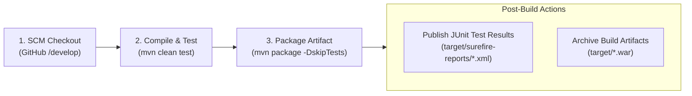

# Continuous Integration (CI) Configuration Guide

## 1. Overview and Objectives

This document specifies the Continuous Integration (CI) pipeline architecture and configuration for the **Containerized Mobile Plan Recommendation Platform** using Jenkins. The primary goal of this CI job is to guarantee code quality, verify regression-free integration, and package deployable build artifacts automatically upon every commit.

### Project Context
- **Repository:** `https://github.com/SrishtiYadav1904/containerized-mobile-plan-recommendation-platform.git`
- **Owner:** `SrishtiYadav1904`
- **Integration Branch:** `develop`
- **Release Branch:** `main`
- **CI Tool:** Jenkins 2.568.1 running on local host port `8080`
- **Build Tool:** Apache Maven 3.9.9 / Maven Wrapper (`mvnw.cmd`)
- **JDK:** Java 21 LTS (Oracle JDK 21.0.12)
- **Artifact Type:** Standalone & Tomcat-compatible Web Application Archive (`.war`)

---

## 2. Pipeline Workflow & Stages

The CI job follows an automated, fail-fast sequence:



### Stage Breakdown:
1. **SCM Checkout:** Clones the latest commit from the target branch using Git.
2. **Compile and Test:** Executes `mvn clean test` to compile source code and run all 30 automated unit, repository, and controller slice tests against the in-memory H2 test database. If any test fails, the build terminates immediately with failure.
3. **Package:** Runs `mvn package -DskipTests` to package the Spring Boot WAR artifact into `target/containerized-mobile-plan-recommendation-platform-0.0.1-SNAPSHOT.war`.
4. **Post Actions (Always):**
   - **JUnit Reporting:** Discovers and publishes test reports from `target/surefire-reports/*.xml`. Generates trend charts in the Jenkins UI.
   - **Artifact Archiving:** Archives `target/*.war` and fingerprints the binary for traceability and downstream deployment in Task 8.

---

## 3. Trigger Configuration

### A. Polling Schedule (SCM Poll)
To support environments where inbound webhooks cannot reach the local developer machine behind NAT/firewall:
- **Expression:** `H/15 * * * *`
- **Behavior:** Jenkins polls GitHub every 15 minutes using hash spread (`H`) to balance server load. If a new commit hash is detected, a build is automatically enqueued.

### B. GitHub Webhook (Push Trigger)
For public or tunneled Jenkins endpoints:
- **Payload URL:** `http://<public-ip-or-ngrok>:8080/github-webhook/`
- **Content Type:** `application/json`
- **Events:** Just the `push` event.
- **Job Trigger:** Enable *"GitHub hook trigger for GITScm polling"*.

---

## 4. Credentials & Security Policy

- **No Secrets in Source Control:** Database credentials, API tokens, and private keys must never be committed to Git.
- **Public Repository Access:** The repository is public; Jenkins accesses it via HTTPS without requiring hardcoded personal access tokens.
- **Jenkins Credentials Store:** When private credentials are required for future tasks (e.g. Docker Hub, deployment tokens), they are configured via Jenkins Credentials Manager (`Manage Jenkins -> Credentials`) and referenced securely by ID.

---

## 5. Port Allocation & Collision Safeguards

To prevent collisions with existing running services:
- **Jenkins Controller Port:** `8080` (Existing installation preserved)
- **Tomcat Deployment Port:** `8084` (Planned for Task 8)
- **Docker Host Port:** `8085` (Planned for Task 11)
- **Forbidden Ports:** `8072`, `8081`, and `8082` are actively utilized by other applications and must **never** be bound by this platform.

---

## 6. Jenkins Job Definition (Declarative Pipeline)

```groovy
pipeline {
    agent any
    
    triggers {
        pollSCM('H/15 * * * *')
        githubPush()
    }
    
    options {
        buildDiscarder(logRotator(numToKeepStr: '10'))
        timestamps()
        timeout(time: 15, unit: 'MINUTES')
    }
    
    stages {
        stage('Checkout') {
            steps {
                git branch: 'develop', url: 'https://github.com/SrishtiYadav1904/containerized-mobile-plan-recommendation-platform.git'
            }
        }
        
        stage('Compile and Test') {
            steps {
                bat 'mvn clean test'
            }
        }
        
        stage('Package') {
            steps {
                bat 'mvn package -DskipTests'
            }
        }
    }
    
    post {
        always {
            junit allowEmptyResults: true, testResults: 'target/surefire-reports/*.xml'
            archiveArtifacts allowEmptyArchive: true, artifacts: 'target/*.war,target/*.jar', fingerprint: true
        }
        success {
            echo '========================================================'
            echo 'CI Pipeline completed successfully! Artifacts archived.'
            echo '========================================================'
        }
        failure {
            echo '========================================================'
            echo 'CI Pipeline failed during execution. Please inspect logs.'
            echo '========================================================'
        }
    }
}
```
