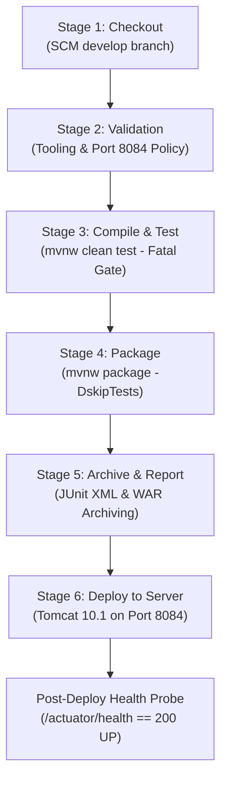

# Server Deployment Guide — Apache Tomcat 10.1 & Pipeline as Code

## 1. Overview and Objectives

This guide documents the server deployment architecture, configuration steps, and operational verification procedures for deploying the **Containerized Mobile Plan Recommendation Platform** to Apache Tomcat 10.1 on port `8084`.

### Project Deployment Context
- **Application Artifact:** `containerized-mobile-plan-recommendation-platform.war` (Spring Boot 3 / Servlet 6.0 compatible WAR)
- **Target Application Server:** Apache Tomcat 10.1.x
- **Host Port:** `8084` (Approved Tomcat port in port policy)
- **Actuator Health URL:** `http://localhost:8084/mpr-platform/actuator/health`
- **Application URL:** `http://localhost:8084/mpr-platform/`
- **Forbidden Ports:** `8072`, `8081`, and `8082` are reserved and must **never** be used.

---

## 2. Pipeline as Code Architecture (`Jenkinsfile`)

The repository includes a declarative `Jenkinsfile` that defines the end-to-end continuous integration and deployment pipeline:



### Pipeline Parameters:
- `DEPLOY_ENV`: Deployment target (`local-tomcat`, `staging`, `production`).
- `APP_PORT`: Application port (Defaults to `8084`; guarded against forbidden ports `8072, 8081, 8082`).
- `TOMCAT_HOME`: Directory path where Apache Tomcat 10.1 is installed (Defaults to `E:\Downloads\apache-tomcat-10.1.61` with auto-fallback to `C:\apache-tomcat-10.1`).
- `DEPLOY_WAR`: Boolean toggle to execute server deployment stage.

---

## 3. Apache Tomcat 10.1 Installation & Configuration (Step-by-Step)

### Step 1: Download Apache Tomcat 10.1
1. Navigate to the official Apache Tomcat download portal: [https://tomcat.apache.org/download-10.cgi](https://tomcat.apache.org/download-10.cgi).
2. Download the **64-bit Windows zip** (e.g. `apache-tomcat-10.1.x-windows-x64.zip`).
3. Extract the archive to the standard directory:
   ```powershell
   Expand-Archive -Path "apache-tomcat-10.1.x-windows-x64.zip" -DestinationPath "C:\"
   Rename-Item -Path "C:\apache-tomcat-10.1.x" -NewName "C:\apache-tomcat-10.1"
   ```

### Step 2: Configure Port 8084 in `conf/server.xml`
1. Open `C:\apache-tomcat-10.1\conf\server.xml` in an editor.
2. Locate the default HTTP connector on port `8080`:
   ```xml
   <!-- Change from 8080 to 8084 to prevent conflict with Jenkins (8080) -->
   <Connector port="8084" protocol="HTTP/1.1"
              connectionTimeout="20000"
              redirectPort="8443"
              maxParameterCount="1000" />
   ```
3. Locate the Server shutdown port and modify it to avoid collision:
   ```xml
   <Server port="8006" shutdown="SHUTDOWN">
   ```

### Step 3: Configure Manager Roles in `conf/tomcat-users.xml`
1. Open `C:\apache-tomcat-10.1\conf\tomcat-users.xml`.
2. Add manager roles before the closing `</tomcat-users>` tag:
   ```xml
   <role rolename="manager-gui"/>
   <role rolename="manager-script"/>
   <user username="tomcat-deployer" password="CHANGE_ME_SECURE_PASSWORD" roles="manager-gui,manager-script"/>
   ```

### Step 4: Start Apache Tomcat
In PowerShell:
```powershell
# Set environment variables if needed
$env:CATALINA_HOME = "C:\apache-tomcat-10.1"
# Start Tomcat
& "C:\apache-tomcat-10.1\bin\startup.bat"
```
Verify listening port:
```powershell
netstat -ano | findstr :8084
```

---

## 4. Application Deployment Procedures

### Method A: Automated Deployment via Jenkins Pipeline
1. Ensure `TOMCAT_HOME` parameter matches your installation path (`C:\apache-tomcat-10.1`).
2. Trigger the pipeline job `Mobile-Plan-Recommendation-CI` in Jenkins.
3. The pipeline verifies tests, packages `target/*.war`, copies it to `C:\apache-tomcat-10.1\webapps\mpr-platform.war`, and executes the automated health probe.

### Method B: Manual Drop-in Deployment
```powershell
# Copy packaged WAR to Tomcat webapps directory
Copy-Item -Path "target\containerized-mobile-plan-recommendation-platform.war" -Destination "C:\apache-tomcat-10.1\webapps\mpr-platform.war" -Force
```
Tomcat's auto-deployer will unpack `mpr-platform.war` into `mpr-platform/` within 10–15 seconds.

---

## 5. Post-Deployment Verification & Health Checks

Once deployed, verify the application status:

1. **Actuator Health Probe:**
   ```powershell
   Invoke-RestMethod -Uri "http://localhost:8084/mpr-platform/actuator/health"
   ```
   **Expected Response:**
   ```json
   {
     "status": "UP"
   }
   ```

2. **Web Application Home:**
   Navigate to `http://localhost:8084/mpr-platform/` in a web browser.
   - Verify catalogue listing displays 24 seed plans.
   - Verify light-theme styling with soft pink and lilac accents.

3. **REST API Endpoint Check:**
   ```powershell
   Invoke-RestMethod -Uri "http://localhost:8084/mpr-platform/api/plans"
   ```
   Returns JSON list of published plans.

---

## 6. Port Isolation & Conflict Safeguards

| Component | Port | Status / Purpose |
|---|---|---|
| **Jenkins Controller** | `8080` | Active CI automation server |
| **Apache Tomcat 10.1** | `8084` | Standalone application server deployment |
| **Docker Host Port** | `8085` | Containerized runtime (Task 11) |
| **Forbidden Port 1** | `8072` | Reserved (Active system process) |
| **Forbidden Port 2** | `8081` | Reserved (Driving School application) |
| **Forbidden Port 3** | `8082` | Reserved (Active system process) |

---

## 7. Troubleshooting & Pending Status Handling

If Tomcat is not yet installed on the developer workstation:
- The pipeline safely runs all checkout, validation, unit test, packaging, and artifact archiving stages.
- The `Deploy to Server` stage detects that Tomcat is not present, outputs an informative pending notice, and passes cleanly without crashing.
- Artifacts remain safely archived in Jenkins and on disk (`target/*.war`) ready for Tomcat deployment or Docker containerization in Task 11.
